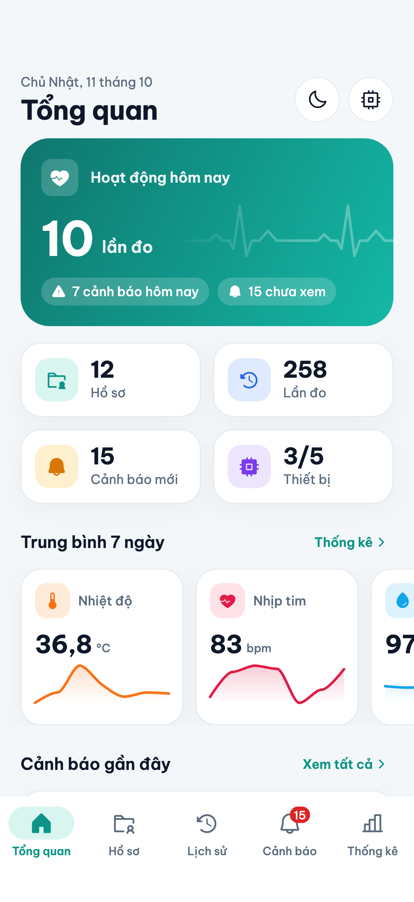
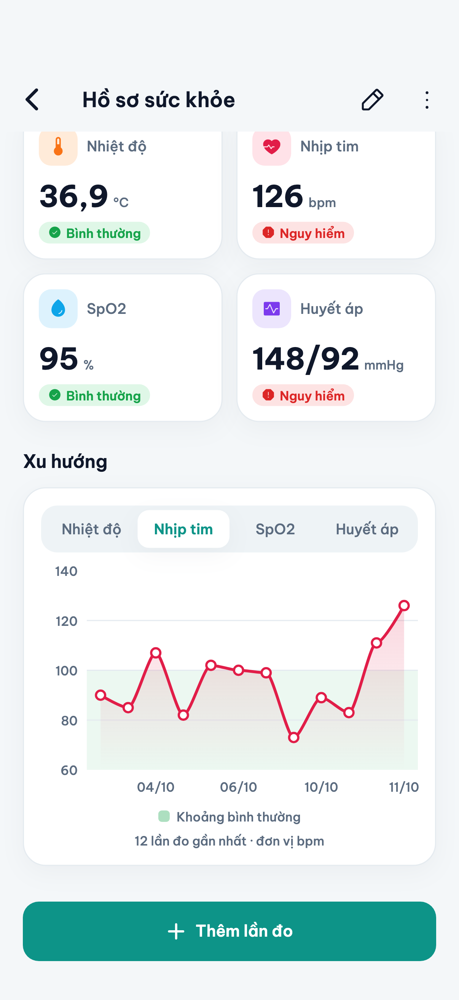

# Hồ Sơ Sức Khỏe

Ứng dụng Flutter (iOS + Android) cho đồ án Cơ sở dữ liệu **"Quản lý hồ sơ sức khỏe và lịch sử theo dõi chỉ số sức khỏe"** — phần *Giao diện và kiểm thử* (Người 12).

Hiện tại app **chỉ có giao diện, chạy trên dữ liệu mẫu trong bộ nhớ**. Phần CSDL thật (Người 1–11) sẽ được nối vào sau mà không phải sửa giao diện — xem [Nối với CSDL thật](#nối-với-csdl-thật).

| Tổng quan | Hồ sơ | Chi tiết lần đo | Thống kê |
|---|---|---|---|
|  |  |  |  |

Toàn bộ ảnh chụp (kể cả giao diện tối) nằm trong [docs/screenshots](docs/screenshots).

## Các màn hình

| Màn hình | Nội dung |
|---|---|
| Tổng quan | Hoạt động hôm nay, số hồ sơ / lần đo / cảnh báo / thiết bị, trung bình 7 ngày, cảnh báo và lần đo gần đây |
| Danh sách hồ sơ | Tìm theo họ tên (không phân biệt dấu), lọc theo giới tính và nhóm tuổi |
| Chi tiết hồ sơ | Thông tin cá nhân, chiều cao / cân nặng / BMI / nhóm máu, tiền sử bệnh, dị ứng, chỉ số mới nhất, biểu đồ xu hướng |
| Lịch sử đo | Lọc theo người, khoảng thời gian (hôm nay, 7 ngày, tháng, tùy chọn) và nguồn dữ liệu |
| Chi tiết lần đo | Từng chỉ số kèm đánh giá và thanh ngưỡng, cảnh báo liên quan |
| Cảnh báo | Lọc theo mức độ / chưa xem, đánh dấu đã xem |
| Thống kê | Diễn biến chỉ số, số lần đo theo ngày, phân loại kết quả, bảng TB / thấp nhất / cao nhất, xếp hạng cảnh báo |
| Thiết bị | Danh sách thiết bị mô phỏng và trạng thái |
| Form | Thêm / sửa hồ sơ, thêm lần đo — có kiểm tra dữ liệu nhập |

## Chạy app

Cần Flutter 3.47 trở lên (Dart 3.13).

```bash
flutter pub get
```

```bash
flutter run
```

Mở bằng Xcode: `ios/Runner.xcworkspace`. Để chạy trên iPhone thật, chọn Team của bạn ở *Runner → Signing & Capabilities*.

## Build bản phát hành

```bash
tool/build_release.sh
```

Kết quả nằm trong `dist/`:

- `HoSoSucKhoe-<phiên bản>-unsigned.ipa` — bản iOS **chưa ký**. Cài lên iPhone bằng công cụ tự ký như Sideloadly hoặc AltStore.
- `HoSoSucKhoe-<phiên bản>.apk` — bản Android, ký bằng debug key mặc định của Flutter (cài trực tiếp được, chưa dùng để đưa lên Play Store).

Build riêng từng nền tảng: `tool/build_release.sh ios` hoặc `tool/build_release.sh android`.

## Kiến trúc

Feature-first clean architecture: mỗi tính năng có ba tầng `domain` (entity + interface repository), `data` (cài đặt repository) và `presentation` (Cubit + màn hình).

```
lib/
├── main.dart
├── app/            Widget gốc, khung 5 tab, chế độ sáng/tối
├── core/           Theme, router, DI, widget dùng chung, tiện ích
├── mock/           Cơ sở dữ liệu mẫu trong bộ nhớ
└── features/
    ├── tong_quan/  ├── ho_so/      ├── lan_do/
    ├── canh_bao/   ├── thong_ke/   └── thiet_bi/
```

| Việc | Thư viện |
|---|---|
| Quản lý trạng thái | `flutter_bloc` (Cubit) + `freezed` |
| Điều hướng | `auto_route` |
| Dependency injection | `get_it` + `injectable` |
| Biểu đồ | `fl_chart` |

Sau khi sửa file có annotation (`@freezed`, `@injectable`, `@RoutePage`), sinh lại mã:

```bash
dart run build_runner build
```

## Nối với CSDL thật

Entity trong `lib/features/*/domain/entity` bám theo 7 bảng của đồ án:

| Bảng | Entity | File |
|---|---|---|
| `NGUOI_DUNG` | `NguoiDung` | `ho_so/domain/entity/nguoi_dung.dart` |
| `HO_SO_SUC_KHOE` | `HoSoSucKhoe` | `ho_so/domain/entity/ho_so_suc_khoe.dart` |
| `THIET_BI` | `ThietBi` | `thiet_bi/domain/entity/thiet_bi.dart` |
| `LOAI_CHI_SO` | `LoaiChiSo` | `lan_do/domain/entity/loai_chi_so.dart` |
| `LAN_DO`, `CHI_TIET_LAN_DO` | `LanDo`, `ChiTietLanDo` | `lan_do/domain/entity/lan_do.dart` |
| `CANH_BAO` | `CanhBao` | `canh_bao/domain/entity/canh_bao.dart` |

Tên trường và ngưỡng đánh giá hiện là **tạm thời**, sẽ chỉnh theo ERD và quy tắc cảnh báo chính thức của nhóm.

Giao diện chỉ gọi các interface `*Repository` ở tầng domain. Để dùng CSDL thật:

1. Viết lớp cài đặt mới cho từng interface (gọi API hoặc SQL), đặt cạnh các lớp `Mock*Repository` trong `lib/features/*/data/repository_impl/`.
2. Chuyển annotation `@LazySingleton(as: ...)` từ lớp `Mock*` sang lớp mới rồi chạy lại `build_runner`.
3. Xóa `lib/mock/` khi không còn dùng.

Repository trả về `Either<Failure, T>`; sau mỗi thao tác thêm / sửa / xóa cần gọi `DataRefreshBus.notify()` để các màn hình tự tải lại.

## Kiểm thử

```bash
flutter test
```

- `test/mock_database_test.dart` — ràng buộc của dữ liệu mẫu: khóa chính không trùng, khóa ngoại hợp lệ, cảnh báo sinh đúng ngưỡng, xóa dây chuyền.
- `test/app_smoke_test.dart` — app khởi động và điều hướng được qua các tab.

## Công cụ

| Lệnh | Tác dụng |
|---|---|
| `flutter test tool/chup_man_hinh_test.dart` | Chụp lại ảnh mọi màn hình vào `docs/screenshots/` |
| `flutter test tool/tao_icon_test.dart` rồi `dart run flutter_launcher_icons` | Vẽ lại icon app và hình màn hình khởi động |

## Tài nguyên bên thứ ba

- Font [Be Vietnam Pro](https://github.com/bettergui/BeVietnamPro) — SIL Open Font License 1.1 (`assets/fonts/BeVietnamPro-OFL.txt`).
- Icon [Phosphor](https://phosphoricons.com) — MIT (`assets/fonts/phosphor/LICENSE.txt`).

## Tài liệu

- [Phân công công việc của nhóm](docs/Phan_cong_do_an_CSDL_quan_ly_ho_so_suc_khoe.docx)
