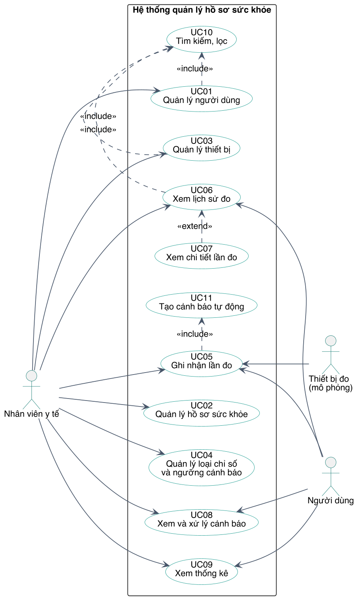
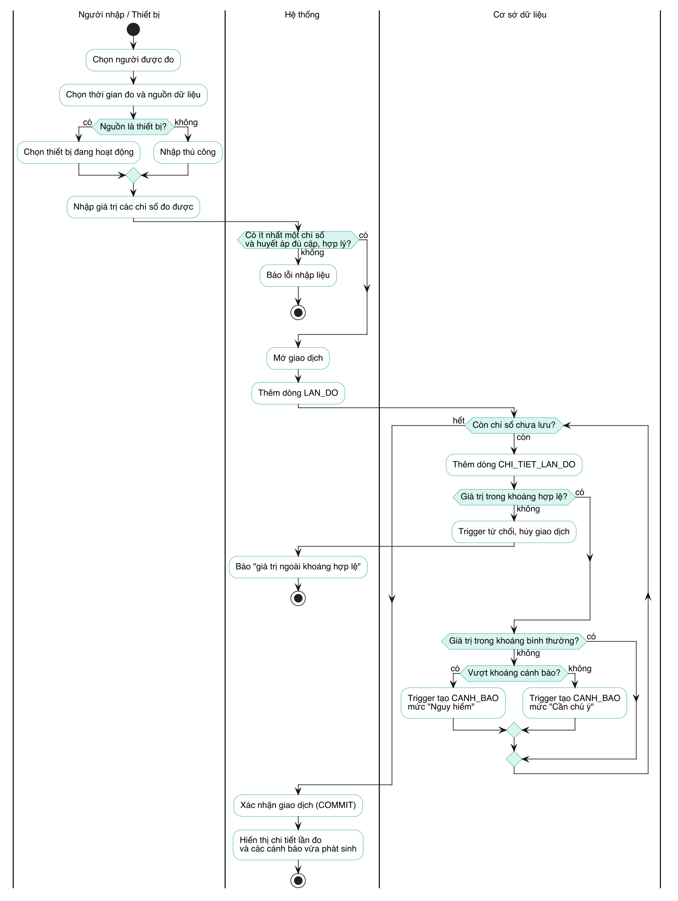
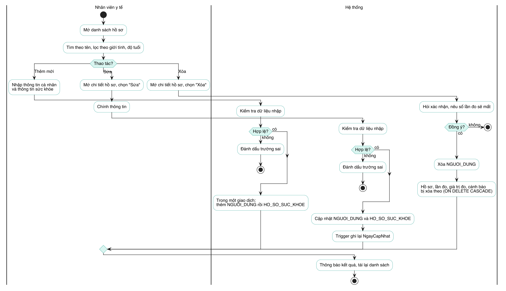
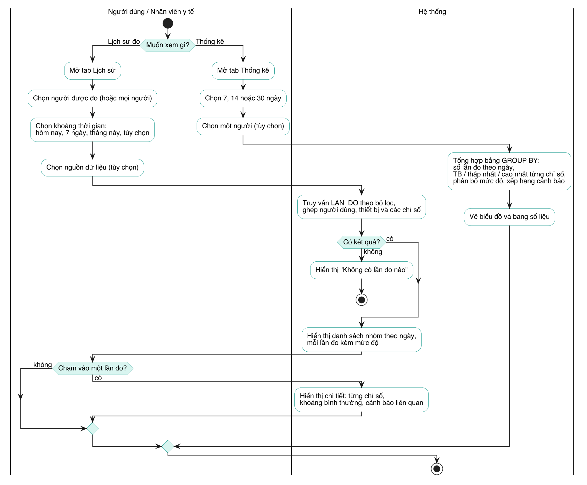
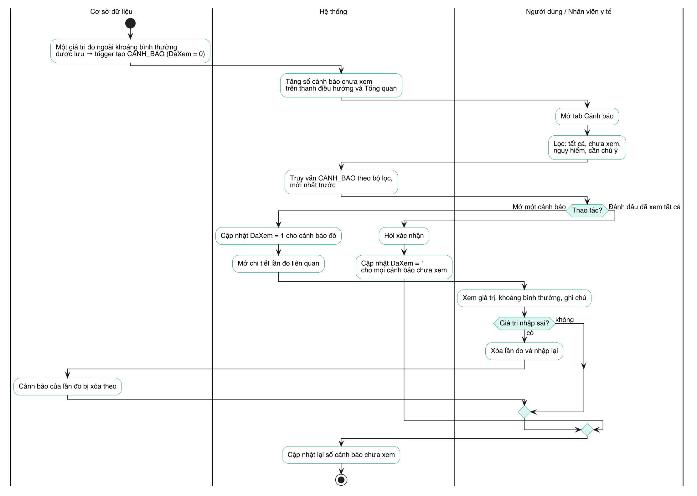

# Phần 2 — Use Case và phân tích nghiệp vụ

**Người phụ trách:** Người 2 · **Đầu vào:** yêu cầu ở [Phần 1](01_phan_tich_yeu_cau.md) · **Sơ đồ nguồn:** [`docs/so_do/`](so_do) (PlantUML)

## 1. Tác nhân

| Tác nhân | Vai trò |
|---|---|
| **Nhân viên y tế** | Quản lý người dùng, hồ sơ, thiết bị, loại chỉ số; ghi nhận lần đo; theo dõi cảnh báo và thống kê của mọi người |
| **Người dùng** | Người được theo dõi sức khỏe: tự ghi nhận lần đo, xem lịch sử, cảnh báo và thống kê của mình |
| **Thiết bị đo (mô phỏng)** | Tác nhân phụ: nguồn phát sinh lần đo. Trong đề tài, dữ liệu thiết bị là dữ liệu mẫu |

## 2. Use Case Diagram

| Mã | Use Case | Tác nhân | Yêu cầu liên quan (Phần 1) |
|---|---|---|---|
| UC01 | Quản lý người dùng | Nhân viên y tế | YC-01 – YC-06 |
| UC02 | Quản lý hồ sơ sức khỏe | Nhân viên y tế | YC-07 – YC-10 |
| UC03 | Quản lý thiết bị | Nhân viên y tế | YC-20 – YC-23 |
| UC04 | Quản lý loại chỉ số và ngưỡng cảnh báo | Nhân viên y tế | YC-11 – YC-13 |
| UC05 | Ghi nhận lần đo | Nhân viên y tế, Người dùng, Thiết bị đo | YC-14 – YC-16 |
| UC06 | Xem lịch sử đo | Nhân viên y tế, Người dùng | YC-17, YC-18 |
| UC07 | Xem chi tiết lần đo | Nhân viên y tế, Người dùng | YC-19 |
| UC08 | Xem và xử lý cảnh báo | Nhân viên y tế, Người dùng | YC-26 – YC-28 |
| UC09 | Xem thống kê | Nhân viên y tế, Người dùng | YC-29 – YC-32 |
| UC10 | Tìm kiếm, lọc | (được bao gồm) | YC-05, YC-06, YC-22 |
| UC11 | Tạo cảnh báo tự động | (được bao gồm) | YC-24, YC-25 |

Quan hệ giữa các Use Case:

- **UC01, UC03, UC06 «include» UC10.** Danh sách người dùng, thiết bị và lịch sử đo đều cần tìm kiếm và lọc; phần chung này được tách thành một Use Case.
- **UC05 «include» UC11.** Mỗi lần ghi nhận giá trị đo đều kéo theo việc đánh giá ngưỡng; người thao tác không gọi riêng UC11.
- **UC07 «extend» UC06.** Từ lịch sử đo, người xem có thể (không bắt buộc) mở chi tiết một lần đo.

## 3. Activity Diagram các quy trình chính

### 3.1 Ghi nhận lần đo

Quy trình trung tâm của hệ thống. Điểm đáng chú ý là dữ liệu được kiểm tra ở hai tầng: hệ thống kiểm tra tính đầy đủ của lần đo (có ít nhất một chỉ số, huyết áp đủ cặp), còn cơ sở dữ liệu kiểm tra từng giá trị bằng trigger và tự tạo cảnh báo. Toàn bộ nằm trong một giao dịch.

### 3.2 Quản lý hồ sơ

Thêm, sửa, xóa hồ sơ. Thêm mới tạo đồng thời người dùng và hồ sơ; xóa người dùng kéo theo toàn bộ dữ liệu liên quan nên phải có bước xác nhận.

### 3.3 Xem lịch sử và thống kê

Hai luồng tra cứu: lịch sử đo (lọc theo người, thời gian, nguồn dữ liệu rồi xem chi tiết) và thống kê (tổng hợp theo khoảng thời gian).

### 3.4 Xử lý cảnh báo

Vòng đời của một cảnh báo: phát sinh từ trigger, hiện ở trạng thái chưa xem, được mở xem hoặc đánh dấu đã xem; nếu giá trị đo bị nhập sai thì cảnh báo mất theo lần đo.

## 4. Đặc tả Use Case

Các mã `QT-…` tham chiếu tới quy tắc nghiệp vụ ở Phần 1, mục 9.

### UC01 — Quản lý người dùng

| Mục | Nội dung |
|---|---|
| Tác nhân | Nhân viên y tế |
| Mô tả | Thêm, sửa, xóa và xem thông tin cá nhân của người được theo dõi sức khỏe |
| Tiền điều kiện | Không |
| Hậu điều kiện | Thông tin người dùng được lưu, cập nhật hoặc xóa; danh sách phản ánh thay đổi |
| Luồng chính (thêm) | 1. Nhân viên mở danh sách và chọn "Thêm". 2. Nhập họ tên, giới tính, ngày sinh; tùy chọn số điện thoại, email, địa chỉ. 3. Hệ thống kiểm tra dữ liệu. 4. Hệ thống lưu người dùng và cấp mã. 5. Hệ thống hiển thị thông tin vừa lưu. |
| Luồng thay thế | **Sửa:** chọn một người, chỉnh thông tin, lưu; các bước kiểm tra như khi thêm. **Xóa:** chọn một người, chọn "Xóa"; hệ thống nêu rõ dữ liệu sẽ mất và hỏi xác nhận; nếu đồng ý thì xóa người dùng cùng hồ sơ, lần đo và cảnh báo (QT-11). |
| Ngoại lệ | 3a. Thiếu trường bắt buộc, ngày sinh ở tương lai, số điện thoại có ký tự không phải số (QT-15, QT-16): hệ thống chỉ ra trường sai, không lưu. 4a. Email trùng với người khác (QT-14): hệ thống báo lỗi, không lưu. |
| Bao gồm | UC10 — Tìm kiếm, lọc |

### UC02 — Quản lý hồ sơ sức khỏe

| Mục | Nội dung |
|---|---|
| Tác nhân | Nhân viên y tế |
| Mô tả | Lập và cập nhật hồ sơ sức khỏe nền của một người dùng |
| Tiền điều kiện | Người dùng đã tồn tại |
| Hậu điều kiện | Hồ sơ được lưu; thời điểm cập nhật được ghi lại |
| Luồng chính | 1. Nhân viên chọn một người dùng. 2. Nhập hoặc chỉnh chiều cao, cân nặng, nhóm máu, tiền sử bệnh, dị ứng. 3. Hệ thống kiểm tra dữ liệu. 4. Hệ thống lưu hồ sơ và tự ghi thời điểm cập nhật. 5. Hệ thống hiển thị hồ sơ kèm BMI tính từ chiều cao và cân nặng. |
| Luồng thay thế | 1a. Lập hồ sơ ngay khi thêm người dùng mới: người dùng và hồ sơ được lưu trong cùng một giao dịch. |
| Ngoại lệ | 3a. Chiều cao, cân nặng ngoài khoảng cho phép hoặc nhóm máu không hợp lệ (QT-15, QT-16): không lưu. 4a. Người dùng đã có hồ sơ mà lại lập hồ sơ thứ hai (QT-01): hệ thống từ chối. |

### UC03 — Quản lý thiết bị

| Mục | Nội dung |
|---|---|
| Tác nhân | Nhân viên y tế |
| Mô tả | Quản lý danh sách thiết bị đo và trạng thái của chúng |
| Tiền điều kiện | Không |
| Hậu điều kiện | Thiết bị được thêm, cập nhật trạng thái hoặc xóa |
| Luồng chính | 1. Nhân viên mở danh sách thiết bị. 2. Chọn thêm thiết bị; nhập tên, loại, mã định danh, mô tả. 3. Hệ thống kiểm tra và lưu thiết bị ở trạng thái "Hoạt động". |
| Luồng thay thế | **Đổi trạng thái:** chuyển thiết bị sang "Bảo trì" hoặc "Ngừng sử dụng", hoặc đưa trở lại "Hoạt động". **Xóa:** chỉ thực hiện được với thiết bị chưa có lần đo nào. |
| Ngoại lệ | 3a. Mã định danh trùng với thiết bị khác (QT-14): không lưu. Xóa thiết bị đã có lần đo (QT-12): hệ thống từ chối và đề nghị chuyển sang "Ngừng sử dụng". |
| Bao gồm | UC10 — Tìm kiếm, lọc |

### UC04 — Quản lý loại chỉ số và ngưỡng cảnh báo

| Mục | Nội dung |
|---|---|
| Tác nhân | Nhân viên y tế |
| Mô tả | Quản lý danh mục chỉ số, đơn vị đo và ba khoảng đánh giá của từng chỉ số |
| Tiền điều kiện | Không |
| Hậu điều kiện | Danh mục và ngưỡng được cập nhật; các giá trị đo ghi nhận **sau đó** được đánh giá theo ngưỡng mới |
| Luồng chính | 1. Nhân viên xem danh mục chỉ số. 2. Chọn một chỉ số, chỉnh khoảng bình thường hoặc khoảng cảnh báo. 3. Hệ thống kiểm tra thứ tự các ngưỡng. 4. Hệ thống lưu thay đổi. |
| Luồng thay thế | 2a. Thêm một loại chỉ số mới với tên, đơn vị và các ngưỡng. |
| Ngoại lệ | 3a. Các khoảng không lồng nhau đúng thứ tự (QT-17): không lưu. Xóa loại chỉ số đã có giá trị đo (QT-13): hệ thống từ chối. |
| Ghi chú | Cảnh báo đã phát sinh giữ nguyên nội dung và mức độ cũ; chúng không được tính lại khi ngưỡng thay đổi. |

### UC05 — Ghi nhận lần đo

| Mục | Nội dung |
|---|---|
| Tác nhân | Nhân viên y tế, Người dùng, Thiết bị đo (mô phỏng) |
| Mô tả | Lưu một lần đo gồm người được đo, thời gian, nguồn dữ liệu và giá trị của một hoặc nhiều chỉ số |
| Tiền điều kiện | Người được đo đã tồn tại. Nếu nguồn là thiết bị thì thiết bị đã tồn tại |
| Hậu điều kiện | Lần đo và các giá trị được lưu trọn vẹn; cảnh báo được tạo cho mỗi giá trị bất thường. Nếu có lỗi thì không dữ liệu nào được lưu |
| Luồng chính | 1. Tác nhân chọn người được đo. 2. Chọn thời gian đo (mặc định là hiện tại) và nguồn dữ liệu. 3. Nếu nguồn là thiết bị: chọn một thiết bị đang hoạt động. 4. Nhập giá trị các chỉ số đo được. 5. Hệ thống kiểm tra lần đo có ít nhất một chỉ số và huyết áp đủ cặp, hợp lý. 6. Hệ thống mở giao dịch, lưu lần đo rồi lưu từng giá trị. 7. Với mỗi giá trị, cơ sở dữ liệu kiểm tra khoảng hợp lệ và thực hiện UC11. 8. Hệ thống xác nhận giao dịch và hiển thị chi tiết lần đo cùng cảnh báo vừa phát sinh. |
| Ngoại lệ | 5a. Không có chỉ số nào (QT-03), chỉ nhập một trong hai giá trị huyết áp hoặc tâm thu không lớn hơn tâm trương (QT-04): báo lỗi, không lưu. 6a. Thời gian đo ở tương lai (QT-06), nguồn dữ liệu không khớp thiết bị (QT-05): cơ sở dữ liệu từ chối. 7a. Một giá trị ngoài khoảng hợp lệ (QT-07): hủy toàn bộ giao dịch, báo "giá trị ngoài khoảng hợp lệ". |
| Bao gồm | UC11 — Tạo cảnh báo tự động |

### UC06 — Xem lịch sử đo

| Mục | Nội dung |
|---|---|
| Tác nhân | Nhân viên y tế, Người dùng |
| Mô tả | Tra cứu các lần đo theo người và theo thời gian |
| Tiền điều kiện | Không |
| Hậu điều kiện | Không thay đổi dữ liệu |
| Luồng chính | 1. Tác nhân mở lịch sử đo. 2. Chọn một người, hoặc để xem mọi người. 3. Chọn khoảng thời gian: hôm nay, 7 ngày, tháng này hoặc khoảng tùy chọn. 4. Tùy chọn: lọc theo nguồn dữ liệu. 5. Hệ thống hiển thị các lần đo, mới nhất trước, nhóm theo ngày; mỗi lần đo kèm các chỉ số chính và mức độ nặng nhất. |
| Ngoại lệ | 5a. Không có lần đo nào thỏa bộ lọc: hiển thị thông báo trống. |
| Bao gồm / mở rộng | Bao gồm UC10; được mở rộng bởi UC07 |

### UC07 — Xem chi tiết lần đo

| Mục | Nội dung |
|---|---|
| Tác nhân | Nhân viên y tế, Người dùng |
| Mô tả | Xem đầy đủ một lần đo |
| Tiền điều kiện | Lần đo tồn tại |
| Hậu điều kiện | Không thay đổi dữ liệu, trừ khi tác nhân xóa lần đo |
| Luồng chính | 1. Tác nhân chọn một lần đo từ lịch sử, từ hồ sơ hoặc từ một cảnh báo. 2. Hệ thống hiển thị người được đo, thời gian, nguồn dữ liệu, thiết bị, ghi chú. 3. Hệ thống hiển thị từng chỉ số: giá trị, đơn vị, khoảng bình thường và mức độ đánh giá. 4. Hệ thống hiển thị các cảnh báo của lần đo. |
| Luồng thay thế | 4a. Tác nhân xóa lần đo (sau khi xác nhận): các giá trị và cảnh báo của lần đo bị xóa theo. |

### UC08 — Xem và xử lý cảnh báo

| Mục | Nội dung |
|---|---|
| Tác nhân | Nhân viên y tế, Người dùng |
| Mô tả | Theo dõi các cảnh báo và đánh dấu đã xem |
| Tiền điều kiện | Không |
| Hậu điều kiện | Trạng thái đã xem của cảnh báo được cập nhật |
| Luồng chính | 1. Tác nhân mở danh sách cảnh báo; hệ thống hiển thị mới nhất trước. 2. Tùy chọn: lọc theo trạng thái chưa xem, theo mức nguy hiểm hoặc cần chú ý. 3. Tác nhân mở một cảnh báo. 4. Hệ thống đánh dấu cảnh báo là đã xem (QT-10) và mở chi tiết lần đo liên quan (UC07). |
| Luồng thay thế | 3a. Tác nhân chọn "Đánh dấu đã xem tất cả": sau khi xác nhận, mọi cảnh báo chưa xem chuyển sang đã xem. |
| Ghi chú | Cảnh báo không sửa và không tạo bằng tay được; nó chỉ thay đổi khi giá trị đo liên quan thay đổi (QT-09). |

### UC09 — Xem thống kê

| Mục | Nội dung |
|---|---|
| Tác nhân | Nhân viên y tế, Người dùng |
| Mô tả | Xem số liệu tổng hợp trong một khoảng thời gian |
| Tiền điều kiện | Không |
| Hậu điều kiện | Không thay đổi dữ liệu |
| Luồng chính | 1. Tác nhân mở thống kê. 2. Chọn khoảng thời gian: 7, 14 hoặc 30 ngày. 3. Tùy chọn: chọn một người. 4. Hệ thống tổng hợp: số lần đo theo ngày; trung bình, thấp nhất, cao nhất của từng chỉ số; phân bố lần đo theo mức độ; xếp hạng người có nhiều cảnh báo. 5. Hệ thống hiển thị biểu đồ và bảng số liệu. |
| Ngoại lệ | 4a. Không có dữ liệu trong khoảng đã chọn: hiển thị thông báo trống. |

### UC10 — Tìm kiếm, lọc

| Mục | Nội dung |
|---|---|
| Tác nhân | (được bao gồm bởi UC01, UC03, UC06) |
| Mô tả | Thu hẹp một danh sách theo từ khóa và điều kiện |
| Luồng chính | 1. Tác nhân gõ từ khóa hoặc chọn điều kiện lọc. 2. Hệ thống trả về các dòng thỏa mọi điều kiện đã chọn. |
| Quy tắc | Tìm theo tên không phân biệt chữ hoa, chữ thường và dấu: gõ "duc" tìm được "Đức". Người dùng: lọc theo giới tính, độ tuổi. Thiết bị: lọc theo loại, trạng thái. Lần đo: lọc theo người, thời gian, nguồn dữ liệu. |

### UC11 — Tạo cảnh báo tự động

| Mục | Nội dung |
|---|---|
| Tác nhân | (được bao gồm bởi UC05; do cơ sở dữ liệu thực hiện) |
| Mô tả | Đánh giá một giá trị đo theo ngưỡng của loại chỉ số và tạo cảnh báo nếu bất thường |
| Tiền điều kiện | Một giá trị đo vừa được thêm hoặc sửa |
| Hậu điều kiện | Giá trị bất thường có đúng một cảnh báo; giá trị bình thường không có cảnh báo |
| Luồng chính | 1. Lấy các ngưỡng của loại chỉ số. 2. Nếu giá trị ngoài khoảng hợp lệ: từ chối (QT-07). 3. Xóa cảnh báo cũ của giá trị này, nếu có. 4. Nếu giá trị trong khoảng bình thường: kết thúc. 5. Nếu giá trị vượt khoảng cảnh báo: tạo cảnh báo mức "Nguy hiểm"; ngược lại tạo cảnh báo mức "Cần chú ý" (QT-08). 6. Cảnh báo lấy thời điểm phát sinh bằng thời gian đo và ở trạng thái chưa xem. |
| Hiện thực | Trigger `TRG_CHI_TIET_LAN_DO_CanhBao` (Phần 10) |

## 5. Đối chiếu Use Case với sản phẩm

| Use Case | Script SQL Server | Màn hình ứng dụng |
|---|---|---|
| UC01, UC02 | `04_nguoi_dung.sql`, `05_ho_so_suc_khoe.sql` | Danh sách hồ sơ, Chi tiết hồ sơ, Form hồ sơ |
| UC03 | `08_thiet_bi.sql` | Thiết bị đo (chỉ xem, tìm và lọc) |
| UC04 | `06_chi_so.sql` | Không có màn hình riêng; ngưỡng hiển thị ở Chi tiết lần đo |
| UC05 | `07_lan_do.sql`, `SP_ThemLanDo` trong `10_thong_ke.sql` | Form thêm lần đo |
| UC06, UC07 | `07_lan_do.sql`, `06_chi_so.sql` | Lịch sử đo, Chi tiết lần đo |
| UC08 | `09_canh_bao.sql` | Cảnh báo |
| UC09 | `10_thong_ke.sql` | Tổng quan, Thống kê |
| UC10 | Mục "Tìm kiếm và lọc" của từng script | Ô tìm kiếm và chip lọc |
| UC11 | `02_trigger.sql` | Tự động, không có thao tác |

Ứng dụng minh họa chưa có chức năng thêm, sửa, xóa thiết bị và chỉnh ngưỡng chỉ số; hai Use Case UC03 và UC04 được hiện thực đầy đủ ở mức câu lệnh SQL.
