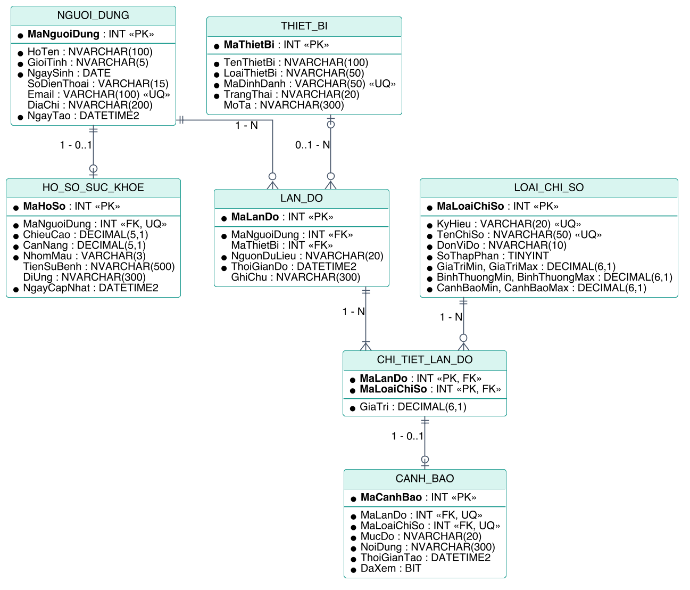

# Phần 4 — Chuẩn hóa và mô hình quan hệ

**Người phụ trách:** Người 4 · **Đầu vào:** ERD ở [Phần 3](03_erd.md) · **Script:** [`sql/sqlserver/01_tao_bang.sql`](../sql/sqlserver/01_tao_bang.sql)

## 1. Mục đích

Phần này làm ba việc:

1. **Kiểm tra** ERD của Phần 3.
2. **Chứng minh** thiết kế đạt chuẩn 3NF, bằng cách đi từ một bảng phẳng chưa chuẩn hóa (cách ghi sổ thông thường) qua 1NF, 2NF, 3NF và cho thấy kết quả trùng với các bảng suy ra từ ERD.
3. **Hoàn thiện** mô hình quan hệ cuối cùng và từ điển dữ liệu.

## 2. Kiểm tra ERD

| Tiêu chí | Kết quả |
|---|---|
| Mỗi thực thể có khóa | Đạt. Sáu thực thể mạnh có khóa riêng; thực thể yếu `CHI_TIET_LAN_DO` có khóa ghép từ hai thực thể chủ |
| Không có thuộc tính lặp lại ở hai thực thể | Đạt. Thông tin về người chỉ ở `NGUOI_DUNG`, về thiết bị chỉ ở `THIET_BI`, về chỉ số chỉ ở `LOAI_CHI_SO` |
| Không lưu thuộc tính dẫn xuất | Đạt. Tuổi và BMI được đánh dấu là dẫn xuất, không lưu |
| Quan hệ N – N đã được tách | Đạt. Lần đo – loại chỉ số được tách qua `CHI_TIET_LAN_DO` |
| Mọi quy tắc nghiệp vụ có chỗ thể hiện | Đạt, với hai quy tắc phải hiện thực bằng trigger hoặc thủ tục vì liên quan nhiều bảng hoặc nhiều dòng: QT-07 (khoảng hợp lệ nằm ở bảng khác) và QT-03, QT-04 (ràng buộc giữa các dòng của cùng một lần đo) |
| Thuộc tính đa trị | Cần lưu ý: `DiUng` (mục 8.4) |
| Thuộc tính kết hợp | "Ngưỡng đánh giá" của `LOAI_CHI_SO` được tách thành sáu cột khi chuyển sang mô hình quan hệ |

## 3. Điểm xuất phát: bảng chưa chuẩn hóa

Giả sử toàn bộ dữ liệu được ghi vào một sổ theo dõi duy nhất, mỗi dòng là một lần đo. Ba dòng dưới đây là dữ liệu thật trong dữ liệu mẫu (lần đo 256, 260 và 261), được ghép lại thành dạng sổ:

| HoTen | NgaySinh | NhomMau | ThoiGianDo | ThietBi | CacChiSo | CanhBao |
|---|---|---|---|---|---|---|
| Ngô Thị Mai | 1964-06-17 | B- | 2026-10-10 07:34:00 | (nhập thủ công) | Nhiệt độ 36.4 °C; Nhịp tim 72 bpm; SpO2 96 %; Huyết áp tâm thu 134 mmHg; Huyết áp tâm trương 72 mmHg | Huyết áp tâm thu: Cần chú ý |
| Đặng Quốc Huy | 1949-12-21 | B+ | 2026-10-10 18:12:00 | ESP32 Health Monitor | Nhiệt độ 36.9 °C; Nhịp tim 126 bpm; SpO2 95 %; Huyết áp tâm thu 148 mmHg; Huyết áp tâm trương 92 mmHg | Nhịp tim: Nguy hiểm; Huyết áp tâm thu: Nguy hiểm; Huyết áp tâm trương: Nguy hiểm |
| Đặng Quốc Huy | 1949-12-21 | B+ | 2026-10-10 18:21:00 | Máy đo SpO2 kẹp ngón | Nhịp tim 96 bpm; SpO2 95 % |  |

Lược đồ đầy đủ của sổ:

```
SO_THEO_DOI(HoTen, GioiTinh, NgaySinh, SoDienThoai, Email, DiaChi,
            ChieuCao, CanNang, NhomMau, TienSuBenh, DiUng, NgayCapNhat,
            ThoiGianDo, NguonDuLieu, GhiChu,
            TenThietBi, LoaiThietBi, MaDinhDanh, TrangThai,
            { TenChiSo, DonViDo, Nguong, GiaTri, MucDoCanhBao, NoiDungCanhBao })
```

Phần trong ngoặc nhọn là một **nhóm lặp**: một dòng chứa nhiều chỉ số. Bảng này gặp đủ ba loại dị thường:

| Dị thường | Ví dụ |
|---|---|
| **Khi thêm** | Không ghi được một người chưa đo lần nào; không khai báo được một thiết bị mới hay một loại chỉ số mới khi chưa có lần đo dùng tới nó |
| **Khi sửa** | Đặng Quốc Huy đổi số điện thoại: phải sửa ở mọi dòng của ông; sót một dòng là dữ liệu mâu thuẫn. Đổi ngưỡng nhịp tim: phải sửa ở mọi dòng có nhịp tim |
| **Khi xóa** | Xóa lần đo duy nhất của một người thì mất luôn thông tin cá nhân và hồ sơ của người đó |

## 4. Phụ thuộc hàm

Để chuẩn hóa, trước hết bổ sung các mã định danh (`MaNguoiDung`, `MaHoSo`, `MaThietBi`, `MaLoaiChiSo`, `MaLanDo`, `MaCanhBao`), vì các thuộc tính tự nhiên không đủ tin cậy làm khóa: hai người có thể trùng họ tên và ngày sinh.

Các phụ thuộc hàm rút ra từ quy tắc nghiệp vụ:

| # | Phụ thuộc hàm | Căn cứ |
|---|---|---|
| F1 | `MaNguoiDung → HoTen, GioiTinh, NgaySinh, SoDienThoai, Email, DiaChi` | Mỗi mã xác định một người |
| F2 | `MaNguoiDung → MaHoSo, ChieuCao, CanNang, NhomMau, TienSuBenh, DiUng, NgayCapNhat` | QT-01: mỗi người tối đa một hồ sơ |
| F3 | `MaHoSo → MaNguoiDung` | QT-01: mỗi hồ sơ của đúng một người |
| F4 | `MaThietBi → TenThietBi, LoaiThietBi, MaDinhDanh, TrangThai` | Mỗi mã xác định một thiết bị |
| F5 | `MaDinhDanh → MaThietBi` | QT-14: mã định danh không trùng |
| F6 | `MaLoaiChiSo → TenChiSo, DonViDo, Nguong` | Mỗi mã xác định một loại chỉ số |
| F7 | `TenChiSo → MaLoaiChiSo` | Tên chỉ số không trùng |
| F8 | `MaLanDo → MaNguoiDung, MaThietBi, NguonDuLieu, ThoiGianDo, GhiChu` | QT-02: mỗi lần đo của đúng một người, tại một thời điểm |
| F9 | `MaLanDo, MaLoaiChiSo → GiaTri` | QT-03: mỗi chỉ số xuất hiện nhiều nhất một lần trong một lần đo |
| F10 | `MaLanDo, MaLoaiChiSo → MaCanhBao, MucDo, NoiDung, ThoiGianTao, DaXem` | QT-09: mỗi giá trị đo nhiều nhất một cảnh báo |
| F11 | `MaCanhBao → MaLanDo, MaLoaiChiSo` | Mỗi cảnh báo xuất phát từ đúng một giá trị đo |

## 5. Dạng chuẩn 1 (1NF)

**Yêu cầu:** mọi thuộc tính mang giá trị nguyên tố; không có nhóm lặp.

**Vi phạm:** nhóm lặp `{TenChiSo, DonViDo, Nguong, GiaTri, …}` — một dòng chứa nhiều chỉ số.

**Xử lý:** tách mỗi chỉ số thành một dòng riêng. Ba dòng ở mục 3 trở thành:

| MaLanDo | MaLoaiChiSo | HoTen | NgaySinh | ThoiGianDo | ThietBi | TenChiSo | DonViDo | GiaTri | MucDoCanhBao |
|---|---|---|---|---|---|---|---|---|---|
| 256 | 1 | Ngô Thị Mai | 1964-06-17 | 2026-10-10 07:34:00 | (nhập thủ công) | Nhiệt độ | °C | 36.399999999999999 |  |
| 256 | 2 | Ngô Thị Mai | 1964-06-17 | 2026-10-10 07:34:00 | (nhập thủ công) | Nhịp tim | bpm | 72.0 |  |
| 256 | 3 | Ngô Thị Mai | 1964-06-17 | 2026-10-10 07:34:00 | (nhập thủ công) | SpO2 | % | 96.0 |  |
| 256 | 4 | Ngô Thị Mai | 1964-06-17 | 2026-10-10 07:34:00 | (nhập thủ công) | Huyết áp tâm thu | mmHg | 134.0 | Cần chú ý |
| 256 | 5 | Ngô Thị Mai | 1964-06-17 | 2026-10-10 07:34:00 | (nhập thủ công) | Huyết áp tâm trương | mmHg | 72.0 |  |
| 260 | 1 | Đặng Quốc Huy | 1949-12-21 | 2026-10-10 18:12:00 | ESP32 Health Monitor | Nhiệt độ | °C | 36.899999999999999 |  |
| 260 | 2 | Đặng Quốc Huy | 1949-12-21 | 2026-10-10 18:12:00 | ESP32 Health Monitor | Nhịp tim | bpm | 126.0 | Nguy hiểm |
| 260 | 3 | Đặng Quốc Huy | 1949-12-21 | 2026-10-10 18:12:00 | ESP32 Health Monitor | SpO2 | % | 95.0 |  |
| 260 | 4 | Đặng Quốc Huy | 1949-12-21 | 2026-10-10 18:12:00 | ESP32 Health Monitor | Huyết áp tâm thu | mmHg | 148.0 | Nguy hiểm |
| 260 | 5 | Đặng Quốc Huy | 1949-12-21 | 2026-10-10 18:12:00 | ESP32 Health Monitor | Huyết áp tâm trương | mmHg | 92.0 | Nguy hiểm |
| 261 | 2 | Đặng Quốc Huy | 1949-12-21 | 2026-10-10 18:21:00 | Máy đo SpO2 kẹp ngón | Nhịp tim | bpm | 96.0 |  |
| 261 | 3 | Đặng Quốc Huy | 1949-12-21 | 2026-10-10 18:21:00 | Máy đo SpO2 kẹp ngón | SpO2 | % | 95.0 |  |

Quan hệ đạt 1NF, với khóa chính là `(MaLanDo, MaLoaiChiSo)`:

```
SO_THEO_DOI_1NF(MaLanDo, MaLoaiChiSo,
                MaNguoiDung, HoTen, GioiTinh, NgaySinh, SoDienThoai, Email, DiaChi,
                MaHoSo, ChieuCao, CanNang, NhomMau, TienSuBenh, DiUng, NgayCapNhat,
                ThoiGianDo, NguonDuLieu, GhiChu,
                MaThietBi, TenThietBi, LoaiThietBi, MaDinhDanh, TrangThai,
                TenChiSo, DonViDo, Nguong,
                GiaTri,
                MaCanhBao, MucDo, NoiDung, ThoiGianTao, DaXem)
```

Bảng đã hết nhóm lặp nhưng dư thừa còn nặng hơn: họ tên và ngày sinh của Đặng Quốc Huy giờ lặp lại ở bảy dòng chỉ cho hai lần đo.

## 6. Dạng chuẩn 2 (2NF)

**Yêu cầu:** đạt 1NF, và mọi thuộc tính không khóa phụ thuộc **đầy đủ** vào khóa chính (không phụ thuộc vào chỉ một phần của khóa).

**Vi phạm:** khóa là `(MaLanDo, MaLoaiChiSo)`, nhưng:

| Phụ thuộc bộ phận | Thuộc tính bị ảnh hưởng |
|---|---|
| Chỉ phụ thuộc `MaLanDo` (F8, rồi F1, F2, F4) | Người được đo, hồ sơ, thời gian, nguồn dữ liệu, thiết bị |
| Chỉ phụ thuộc `MaLoaiChiSo` (F6) | `TenChiSo`, `DonViDo`, `Nguong` |

Chỉ có `GiaTri` và nhóm thuộc tính cảnh báo phụ thuộc đầy đủ vào cả khóa (F9, F10).

**Xử lý:** tách mỗi nhóm phụ thuộc bộ phận thành một quan hệ riêng.

```
LAN_DO_2NF(MaLanDo,
           MaNguoiDung, HoTen, GioiTinh, NgaySinh, SoDienThoai, Email, DiaChi,
           MaHoSo, ChieuCao, CanNang, NhomMau, TienSuBenh, DiUng, NgayCapNhat,
           ThoiGianDo, NguonDuLieu, GhiChu,
           MaThietBi, TenThietBi, LoaiThietBi, MaDinhDanh, TrangThai)

LOAI_CHI_SO(MaLoaiChiSo, TenChiSo, DonViDo, Nguong)

CHI_TIET_2NF(MaLanDo, MaLoaiChiSo, GiaTri,
             MaCanhBao, MucDo, NoiDung, ThoiGianTao, DaXem)
```

Kết quả: tên và ngưỡng của mỗi chỉ số chỉ còn lưu một lần; khai báo được loại chỉ số mới trước khi có lần đo nào.

## 7. Dạng chuẩn 3 (3NF)

**Yêu cầu:** đạt 2NF, và không thuộc tính không khóa nào phụ thuộc **bắc cầu** vào khóa chính (qua một thuộc tính không khóa khác).

**Vi phạm trong `LAN_DO_2NF`:**

| Phụ thuộc bắc cầu | Qua |
|---|---|
| `MaLanDo → MaNguoiDung → HoTen, GioiTinh, NgaySinh, …` | F8 rồi F1 |
| `MaLanDo → MaNguoiDung → MaHoSo, ChieuCao, CanNang, …` | F8 rồi F2 |
| `MaLanDo → MaThietBi → TenThietBi, LoaiThietBi, MaDinhDanh, TrangThai` | F8 rồi F4 |

**Xử lý:** tách thông tin người dùng (kèm hồ sơ) và thiết bị ra khỏi lần đo, chỉ để lại khóa ngoại.

```
NGUOI_DUNG_VA_HO_SO(MaNguoiDung, HoTen, GioiTinh, NgaySinh, SoDienThoai, Email, DiaChi,
                    MaHoSo, ChieuCao, CanNang, NhomMau, TienSuBenh, DiUng, NgayCapNhat)

THIET_BI(MaThietBi, TenThietBi, LoaiThietBi, MaDinhDanh, TrangThai)

LAN_DO(MaLanDo, MaNguoiDung, MaThietBi, NguonDuLieu, ThoiGianDo, GhiChu)
```

`CHI_TIET_2NF` không có phụ thuộc bắc cầu: cả `GiaTri` lẫn nhóm thuộc tính cảnh báo đều phụ thuộc trực tiếp vào khóa `(MaLanDo, MaLoaiChiSo)`. Tới đây mọi quan hệ đã đạt 3NF.

## 8. Các bước tách thêm và những điểm cần bàn

Hai lần tách dưới đây **không do chuẩn hóa bắt buộc** — quan hệ trước khi tách đã đạt 3NF — mà do ý nghĩa của dữ liệu.

### 8.1 Tách hồ sơ sức khỏe khỏi người dùng

Trong `NGUOI_DUNG_VA_HO_SO`, mọi thuộc tính đều phụ thuộc trực tiếp vào `MaNguoiDung`; gộp chung vẫn đạt 3NF. Nhóm vẫn tách thành `NGUOI_DUNG` và `HO_SO_SUC_KHOE` (quan hệ 1 – 1) vì:

- **Hồ sơ là tùy chọn.** Gộp chung thì người chưa lập hồ sơ phải có ba cột bắt buộc (chiều cao, cân nặng, nhóm máu) ở trạng thái `NULL`, làm mất khả năng ràng buộc `NOT NULL` cho chúng.
- **Hai nhóm thông tin thay đổi theo nhịp khác nhau.** Thông tin liên lạc hiếm khi đổi; cân nặng, tiền sử bệnh được cập nhật định kỳ. `NgayCapNhat` chỉ có nghĩa với nhóm thứ hai.
- **Mức độ nhạy cảm khác nhau.** Thông tin y tế tách riêng thì dễ giới hạn quyền truy cập hơn khi hệ thống có phân quyền.

### 8.2 Tách cảnh báo khỏi giá trị đo

Trong `CHI_TIET_2NF`, nhóm thuộc tính cảnh báo phụ thuộc đầy đủ và trực tiếp vào khóa, nên không vi phạm 3NF. Nhưng dữ liệu mẫu cho thấy chỉ 108 trong 1110 giá trị đo có cảnh báo: gộp chung thì hơn 90% số dòng mang năm cột `NULL`. Tách thành `CANH_BAO` với quan hệ 1 – 0..1:

```
CHI_TIET_LAN_DO(MaLanDo, MaLoaiChiSo, GiaTri)
CANH_BAO(MaCanhBao, MaLanDo, MaLoaiChiSo, MucDo, NoiDung, ThoiGianTao, DaXem)
```

Cảnh báo cũng có vòng đời riêng (được đánh dấu đã xem, được liệt kê và lọc độc lập với giá trị đo), nên là một thực thể đúng nghĩa.

### 8.3 Dư thừa có kiểm soát

Thiết kế cuối cùng còn ba chỗ lưu thông tin có thể suy ra được. Cả ba đều là lựa chọn có chủ đích và đều có cơ chế giữ cho dữ liệu không mâu thuẫn:

| Cột | Suy ra được từ | Vì sao vẫn lưu | Cơ chế bảo đảm nhất quán |
|---|---|---|---|
| `LAN_DO.NguonDuLieu` | `MaThietBi` có `NULL` hay không | Yêu cầu của đề tài nêu rõ "quản lý nguồn dữ liệu"; truy vấn dễ đọc hơn; có chỗ cho nguồn mới sau này (nhập từ tệp, đồng bộ từ ứng dụng khác) | `CK_LAN_DO_NguonKhopThietBi` loại bỏ mọi tổ hợp mâu thuẫn |
| `CANH_BAO.MucDo`, `NoiDung` | `GiaTri` và ngưỡng trong `LOAI_CHI_SO` | Là **ảnh chụp tại thời điểm phát sinh**: nếu ngưỡng được chỉnh về sau, cảnh báo cũ vẫn giải thích đúng vì sao nó được tạo | Theo quy ước, không chương trình nào tự chèn vào `CANH_BAO`: cảnh báo chỉ do trigger tạo; sửa giá trị đo thì trigger tạo lại cảnh báo |
| `CANH_BAO.ThoiGianTao` | `LAN_DO.ThoiGianDo` | Liệt kê cảnh báo mới nhất là truy vấn thường xuyên; có cột này thì sắp xếp được bằng chỉ mục mà không phải nối bảng | Trigger gán bằng thời gian đo |

Xét chặt chẽ, với đúng hai nguồn dữ liệu như hiện tại thì `MaLanDo → MaThietBi → NguonDuLieu` là một phụ thuộc bắc cầu; nhóm chấp nhận điều này vì ràng buộc `CHECK` khiến hai cột không thể mâu thuẫn nhau.

### 8.4 Thuộc tính `DiUng` và 1NF

`DiUng` có thể chứa một danh sách (ví dụ "Bụi nhà, lông mèo" trong dữ liệu mẫu), tức về bản chất là thuộc tính đa trị. Nhóm coi nó là một đoạn **mô tả tự do** và lưu trong một cột văn bản, vì hệ thống không có yêu cầu nào cần tra cứu chính xác theo từng chất gây dị ứng; tìm theo từ khóa bằng `LIKE` là đủ. Nếu về sau cần thống kê theo chất gây dị ứng hoặc cảnh báo tương tác thuốc, phải tách thành bảng riêng:

```
DI_UNG(MaHoSo, TenChatGayDiUng)
```

`TienSuBenh` được xử lý tương tự.

### 8.5 Dạng chuẩn Boyce–Codd

Trong cả bảy bảng cuối cùng, vế trái của mọi phụ thuộc hàm đều là khóa (khóa chính hoặc một khóa dự tuyển như `Email`, `MaDinhDanh`, `KyHieu`, `TenChiSo`), nên thiết kế cũng đạt BCNF — ngoại trừ điểm đã nêu về `NguonDuLieu` ở mục 8.3.

## 9. Kiểm tra từng bảng

| Bảng | Khóa chính | Khóa dự tuyển khác | Thuộc tính không khóa phụ thuộc vào | Kết luận |
|---|---|---|---|:---:|
| `NGUOI_DUNG` | `MaNguoiDung` | `Email` (khi có) | Toàn bộ khóa chính, trực tiếp | 3NF |
| `HO_SO_SUC_KHOE` | `MaHoSo` | `MaNguoiDung` | Toàn bộ khóa chính, trực tiếp | 3NF |
| `THIET_BI` | `MaThietBi` | `MaDinhDanh` | Toàn bộ khóa chính, trực tiếp | 3NF |
| `LOAI_CHI_SO` | `MaLoaiChiSo` | `KyHieu`, `TenChiSo` | Toàn bộ khóa chính, trực tiếp | 3NF |
| `LAN_DO` | `MaLanDo` | — | Toàn bộ khóa chính; riêng `NguonDuLieu` xem mục 8.3 | 3NF (có ghi chú) |
| `CHI_TIET_LAN_DO` | `(MaLanDo, MaLoaiChiSo)` | — | `GiaTri` phụ thuộc đầy đủ vào cả hai thành phần của khóa | 3NF |
| `CANH_BAO` | `MaCanhBao` | `(MaLanDo, MaLoaiChiSo)` | Toàn bộ khóa chính, trực tiếp | 3NF |

Kết quả chuẩn hóa trùng với bảy bảng suy ra từ ERD ở Phần 3: hai con đường độc lập cho cùng một thiết kế.

## 10. Mô hình quan hệ cuối cùng

Khóa chính được **in đậm**, khóa ngoại được *in nghiêng*.

- NGUOI_DUNG(**MaNguoiDung**, HoTen, GioiTinh, NgaySinh, SoDienThoai, Email, DiaChi, NgayTao)
- HO_SO_SUC_KHOE(**MaHoSo**, *MaNguoiDung*, ChieuCao, CanNang, NhomMau, TienSuBenh, DiUng, NgayCapNhat)
- THIET_BI(**MaThietBi**, TenThietBi, LoaiThietBi, MaDinhDanh, TrangThai, MoTa)
- LOAI_CHI_SO(**MaLoaiChiSo**, KyHieu, TenChiSo, DonViDo, SoThapPhan, GiaTriMin, GiaTriMax, BinhThuongMin, BinhThuongMax, CanhBaoMin, CanhBaoMax)
- LAN_DO(**MaLanDo**, *MaNguoiDung*, *MaThietBi*, NguonDuLieu, ThoiGianDo, GhiChu)
- CHI_TIET_LAN_DO(***MaLanDo***, ***MaLoaiChiSo***, GiaTri)
- CANH_BAO(**MaCanhBao**, *MaLanDo*, *MaLoaiChiSo*, MucDo, NoiDung, ThoiGianTao, DaXem)



So với ERD mức khái niệm, mô hình quan hệ bổ sung bốn cột kỹ thuật:

| Cột | Mục đích |
|---|---|
| `NGUOI_DUNG.NgayTao` | Ghi nhận thời điểm tạo bản ghi |
| `THIET_BI.MoTa` | Ghi chú tự do về thiết bị |
| `LOAI_CHI_SO.KyHieu` | Mã ngắn, ổn định (ví dụ `NHIP_TIM`) để chương trình nhận biết chỉ số mà không phụ thuộc vào tên hiển thị |
| `LOAI_CHI_SO.SoThapPhan` | Số chữ số thập phân khi hiển thị: nhiệt độ cần một chữ số, nhịp tim thì không |

## 11. Từ điển dữ liệu

Cấu trúc dưới đây được đọc trực tiếp từ cơ sở dữ liệu SQL Server sau khi chạy `01_tao_bang.sql`, nên luôn khớp với script.

### NGUOI_DUNG

| Cột | Kiểu dữ liệu | Bắt buộc | Mặc định | Ý nghĩa |
|---|---|:---:|---|---|
| `MaNguoiDung` | INT IDENTITY | ✓ |  | Khóa chính, tự tăng |
| `HoTen` | NVARCHAR(100) | ✓ |  | Họ và tên |
| `GioiTinh` | NVARCHAR(5) | ✓ |  | Nam, Nữ hoặc Khác |
| `NgaySinh` | DATE | ✓ |  | Ngày sinh |
| `SoDienThoai` | VARCHAR(15) |  |  | Số điện thoại, chỉ gồm chữ số |
| `Email` | VARCHAR(100) |  |  | Thư điện tử |
| `DiaChi` | NVARCHAR(200) |  |  | Địa chỉ liên hệ |
| `NgayTao` | DATETIME2(0) | ✓ | `SYSDATETIME()` | Thời điểm tạo bản ghi |

| Ràng buộc | Loại | Cột | Ý nghĩa |
|---|---|---|---|
| `PK_NGUOI_DUNG` | Khóa chính | MaNguoiDung | Mỗi người dùng một mã duy nhất |
| `CK_NGUOI_DUNG_Email` | CHECK | Email | Có dạng tên@miền.đuôi |
| `CK_NGUOI_DUNG_GioiTinh` | CHECK | GioiTinh | Chỉ nhận Nam, Nữ, Khác |
| `CK_NGUOI_DUNG_HoTen` | CHECK | HoTen | Họ tên có ít nhất 2 ký tự |
| `CK_NGUOI_DUNG_NgaySinh` | CHECK | NgaySinh | Từ năm 1900 và không ở tương lai |
| `CK_NGUOI_DUNG_SoDienThoai` | CHECK | SoDienThoai | 9 đến 12 ký tự, toàn chữ số |
| `UQ_NGUOI_DUNG_Email` | Chỉ mục duy nhất có điều kiện | Email | Email không trùng; cho phép nhiều dòng NULL |

### HO_SO_SUC_KHOE

| Cột | Kiểu dữ liệu | Bắt buộc | Mặc định | Ý nghĩa |
|---|---|:---:|---|---|
| `MaHoSo` | INT IDENTITY | ✓ |  | Khóa chính, tự tăng |
| `MaNguoiDung` | INT | ✓ |  | Người sở hữu hồ sơ |
| `ChieuCao` | DECIMAL(5,1) | ✓ |  | Chiều cao (cm) |
| `CanNang` | DECIMAL(5,1) | ✓ |  | Cân nặng (kg) |
| `NhomMau` | VARCHAR(3) | ✓ |  | Nhóm máu ABO kèm Rh |
| `TienSuBenh` | NVARCHAR(500) |  |  | Tiền sử bệnh |
| `DiUng` | NVARCHAR(300) |  |  | Dị ứng, phân cách bằng dấu phẩy |
| `NgayCapNhat` | DATETIME2(0) | ✓ | `SYSDATETIME()` | Lần cập nhật hồ sơ gần nhất |

| Ràng buộc | Loại | Cột | Ý nghĩa |
|---|---|---|---|
| `PK_HO_SO_SUC_KHOE` | Khóa chính | MaHoSo | Mỗi hồ sơ một mã duy nhất |
| `UQ_HO_SO_SUC_KHOE_MaNguoiDung` | Duy nhất | MaNguoiDung | Mỗi người tối đa một hồ sơ (quan hệ 1–1) |
| `FK_HO_SO_SUC_KHOE_NGUOI_DUNG` | Khóa ngoại → NGUOI_DUNG (xóa dây chuyền) | MaNguoiDung | Hồ sơ phải thuộc một người dùng có thật; xóa người thì xóa hồ sơ |
| `CK_HO_SO_SUC_KHOE_CanNang` | CHECK | CanNang | Từ 1 đến 300 kg |
| `CK_HO_SO_SUC_KHOE_ChieuCao` | CHECK | ChieuCao | Từ 30 đến 250 cm |
| `CK_HO_SO_SUC_KHOE_NhomMau` | CHECK | NhomMau | Một trong 8 nhóm máu |

### THIET_BI

| Cột | Kiểu dữ liệu | Bắt buộc | Mặc định | Ý nghĩa |
|---|---|:---:|---|---|
| `MaThietBi` | INT IDENTITY | ✓ |  | Khóa chính, tự tăng |
| `TenThietBi` | NVARCHAR(100) | ✓ |  | Tên thiết bị |
| `LoaiThietBi` | NVARCHAR(50) | ✓ |  | Loại thiết bị |
| `MaDinhDanh` | VARCHAR(50) | ✓ |  | Địa chỉ MAC hoặc số serial |
| `TrangThai` | NVARCHAR(20) | ✓ | `N'Hoạt động'` | Hoạt động, Bảo trì hoặc Ngừng sử dụng |
| `MoTa` | NVARCHAR(300) |  |  | Ghi chú về thiết bị |

| Ràng buộc | Loại | Cột | Ý nghĩa |
|---|---|---|---|
| `PK_THIET_BI` | Khóa chính | MaThietBi | Mỗi thiết bị một mã duy nhất |
| `UQ_THIET_BI_MaDinhDanh` | Duy nhất | MaDinhDanh | Không có hai thiết bị trùng mã định danh |
| `CK_THIET_BI_LoaiThietBi` | CHECK | LoaiThietBi | Một trong 4 loại thiết bị |
| `CK_THIET_BI_TrangThai` | CHECK | TrangThai | Một trong 3 trạng thái |

### LOAI_CHI_SO

| Cột | Kiểu dữ liệu | Bắt buộc | Mặc định | Ý nghĩa |
|---|---|:---:|---|---|
| `MaLoaiChiSo` | INT IDENTITY | ✓ |  | Khóa chính, tự tăng |
| `KyHieu` | VARCHAR(20) | ✓ |  | Mã ngắn dùng trong chương trình |
| `TenChiSo` | NVARCHAR(50) | ✓ |  | Tên chỉ số |
| `DonViDo` | NVARCHAR(10) | ✓ |  | Đơn vị đo |
| `SoThapPhan` | TINYINT | ✓ | `0` | Số chữ số thập phân khi hiển thị (0 hoặc 1) |
| `GiaTriMin` | DECIMAL(6,1) | ✓ |  | Cận dưới của khoảng hợp lệ |
| `GiaTriMax` | DECIMAL(6,1) | ✓ |  | Cận trên của khoảng hợp lệ |
| `BinhThuongMin` | DECIMAL(6,1) | ✓ |  | Cận dưới của khoảng bình thường |
| `BinhThuongMax` | DECIMAL(6,1) | ✓ |  | Cận trên của khoảng bình thường |
| `CanhBaoMin` | DECIMAL(6,1) | ✓ |  | Dưới mức này là nguy hiểm |
| `CanhBaoMax` | DECIMAL(6,1) | ✓ |  | Trên mức này là nguy hiểm |

| Ràng buộc | Loại | Cột | Ý nghĩa |
|---|---|---|---|
| `PK_LOAI_CHI_SO` | Khóa chính | MaLoaiChiSo | Mỗi loại chỉ số một mã duy nhất |
| `UQ_LOAI_CHI_SO_KyHieu` | Duy nhất | KyHieu | Ký hiệu không trùng |
| `UQ_LOAI_CHI_SO_TenChiSo` | Duy nhất | TenChiSo | Tên chỉ số không trùng |
| `CK_LOAI_CHI_SO_SoThapPhan` | CHECK | SoThapPhan | Chỉ nhận 0 hoặc 1 |
| `CK_LOAI_CHI_SO_ThuTuNguong` | CHECK | (nhiều cột) | Ba khoảng ngưỡng phải lồng nhau đúng thứ tự |

### LAN_DO

| Cột | Kiểu dữ liệu | Bắt buộc | Mặc định | Ý nghĩa |
|---|---|:---:|---|---|
| `MaLanDo` | INT IDENTITY | ✓ |  | Khóa chính, tự tăng |
| `MaNguoiDung` | INT | ✓ |  | Người được đo |
| `MaThietBi` | INT |  |  | Thiết bị đo; NULL nếu nhập thủ công |
| `NguonDuLieu` | NVARCHAR(20) | ✓ |  | Thiết bị hoặc Thủ công |
| `ThoiGianDo` | DATETIME2(0) | ✓ | `SYSDATETIME()` | Thời điểm đo |
| `GhiChu` | NVARCHAR(300) |  |  | Ghi chú của lần đo |

| Ràng buộc | Loại | Cột | Ý nghĩa |
|---|---|---|---|
| `PK_LAN_DO` | Khóa chính | MaLanDo | Mỗi lần đo một mã duy nhất |
| `FK_LAN_DO_NGUOI_DUNG` | Khóa ngoại → NGUOI_DUNG (xóa dây chuyền) | MaNguoiDung | Lần đo phải của một người dùng có thật; xóa người thì xóa lần đo |
| `FK_LAN_DO_THIET_BI` | Khóa ngoại → THIET_BI | MaThietBi | Thiết bị phải tồn tại; không xóa được thiết bị đã có lần đo |
| `CK_LAN_DO_NguonDuLieu` | CHECK | NguonDuLieu | Chỉ nhận Thiết bị, Thủ công |
| `CK_LAN_DO_NguonKhopThietBi` | CHECK | (nhiều cột) | Nguồn Thiết bị phải có mã thiết bị, nguồn Thủ công thì không |
| `CK_LAN_DO_ThoiGianDo` | CHECK | ThoiGianDo | Không ở tương lai |
| `IX_LAN_DO_MaThietBi` | Chỉ mục | MaThietBi | Tăng tốc thống kê theo thiết bị |
| `IX_LAN_DO_NguoiDung_ThoiGian` | Chỉ mục | MaNguoiDung, ThoiGianDo | Tăng tốc truy vấn lịch sử của một người |
| `IX_LAN_DO_ThoiGianDo` | Chỉ mục | ThoiGianDo | Tăng tốc truy vấn theo khoảng thời gian |

### CHI_TIET_LAN_DO

| Cột | Kiểu dữ liệu | Bắt buộc | Mặc định | Ý nghĩa |
|---|---|:---:|---|---|
| `MaLanDo` | INT | ✓ |  | Lần đo chứa giá trị này |
| `MaLoaiChiSo` | INT | ✓ |  | Chỉ số được đo |
| `GiaTri` | DECIMAL(6,1) | ✓ |  | Giá trị đo được |

| Ràng buộc | Loại | Cột | Ý nghĩa |
|---|---|---|---|
| `PK_CHI_TIET_LAN_DO` | Khóa chính | MaLanDo, MaLoaiChiSo | Mỗi chỉ số chỉ xuất hiện một lần trong một lần đo |
| `FK_CHI_TIET_LAN_DO_LAN_DO` | Khóa ngoại → LAN_DO (xóa dây chuyền) | MaLanDo | Giá trị phải thuộc một lần đo có thật; xóa lần đo thì xóa giá trị |
| `FK_CHI_TIET_LAN_DO_LOAI_CHI_SO` | Khóa ngoại → LOAI_CHI_SO | MaLoaiChiSo | Chỉ số phải có trong danh mục; không xóa được loại đang dùng |
| `IX_CHI_TIET_LAN_DO_MaLoaiChiSo` | Chỉ mục | MaLoaiChiSo | Tăng tốc thống kê theo chỉ số |

### CANH_BAO

| Cột | Kiểu dữ liệu | Bắt buộc | Mặc định | Ý nghĩa |
|---|---|:---:|---|---|
| `MaCanhBao` | INT IDENTITY | ✓ |  | Khóa chính, tự tăng |
| `MaLanDo` | INT | ✓ |  | Lần đo phát sinh cảnh báo |
| `MaLoaiChiSo` | INT | ✓ |  | Chỉ số vượt ngưỡng |
| `MucDo` | NVARCHAR(20) | ✓ |  | Cần chú ý hoặc Nguy hiểm |
| `NoiDung` | NVARCHAR(300) | ✓ |  | Câu mô tả cảnh báo |
| `ThoiGianTao` | DATETIME2(0) | ✓ | `SYSDATETIME()` | Thời điểm phát sinh, bằng thời gian đo |
| `DaXem` | BIT | ✓ | `0` | 0 = chưa xem, 1 = đã xem |

| Ràng buộc | Loại | Cột | Ý nghĩa |
|---|---|---|---|
| `PK_CANH_BAO` | Khóa chính | MaCanhBao | Mỗi cảnh báo một mã duy nhất |
| `UQ_CANH_BAO_ChiTiet` | Duy nhất | MaLanDo, MaLoaiChiSo | Mỗi giá trị đo tối đa một cảnh báo |
| `FK_CANH_BAO_CHI_TIET_LAN_DO` | Khóa ngoại → CHI_TIET_LAN_DO (xóa dây chuyền) | MaLanDo, MaLoaiChiSo | Cảnh báo gắn với một giá trị đo có thật; xóa giá trị thì xóa cảnh báo |
| `CK_CANH_BAO_MucDo` | CHECK | MucDo | Chỉ nhận Cần chú ý, Nguy hiểm |
| `IX_CANH_BAO_DaXem` | Chỉ mục | DaXem, ThoiGianTao | Tăng tốc lọc cảnh báo chưa xem |
| `IX_CANH_BAO_ThoiGianTao` | Chỉ mục | ThoiGianTao | Tăng tốc liệt kê cảnh báo mới nhất |

## 12. Quy ước đặt tên

| Đối tượng | Quy ước | Ví dụ |
|---|---|---|
| Bảng | Chữ hoa, không dấu, các từ nối bằng gạch dưới | `HO_SO_SUC_KHOE` |
| Cột | Viết hoa chữ đầu mỗi từ, không dấu | `NgayCapNhat` |
| Khóa chính | `PK_<Bảng>` | `PK_LAN_DO` |
| Khóa ngoại | `FK_<Bảng con>_<Bảng cha>` | `FK_LAN_DO_NGUOI_DUNG` |
| Duy nhất | `UQ_<Bảng>_<Cột>` | `UQ_THIET_BI_MaDinhDanh` |
| CHECK | `CK_<Bảng>_<Cột hoặc ý nghĩa>` | `CK_LAN_DO_NguonKhopThietBi` |
| Mặc định | `DF_<Bảng>_<Cột>` | `DF_CANH_BAO_DaXem` |
| Chỉ mục | `IX_<Bảng>_<Cột>` | `IX_LAN_DO_ThoiGianDo` |
| Trigger | `TRG_<Bảng>_<Ý nghĩa>` | `TRG_CHI_TIET_LAN_DO_CanhBao` |
| View, hàm, thủ tục | `V_`, `FN_`, `SP_` | `V_LAN_DO_TONG_HOP`, `FN_TinhBMI`, `SP_ThemLanDo` |

Mọi ràng buộc đều được đặt tên để thông báo lỗi chỉ rõ quy tắc nào bị vi phạm; bộ kiểm thử ở Phần 12 dựa vào chính các tên này.
