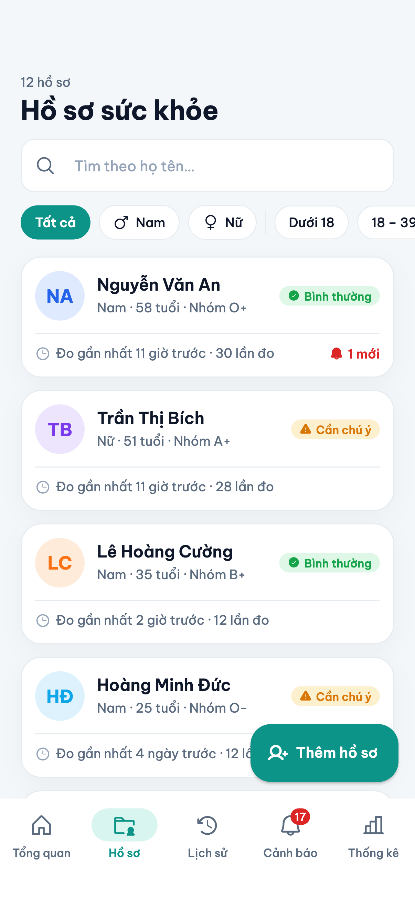
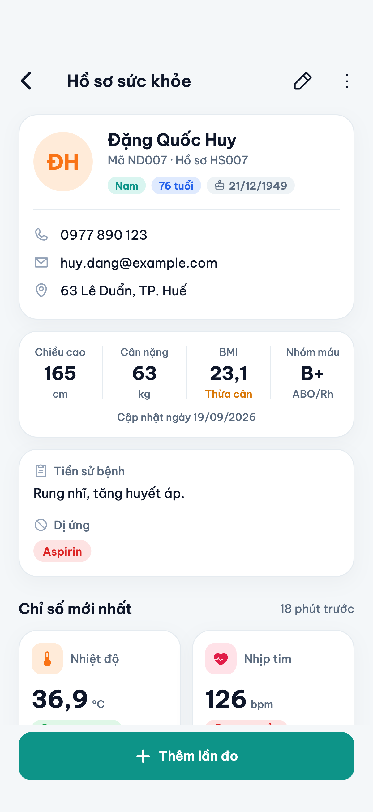
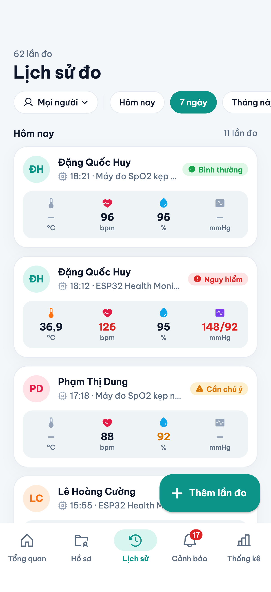
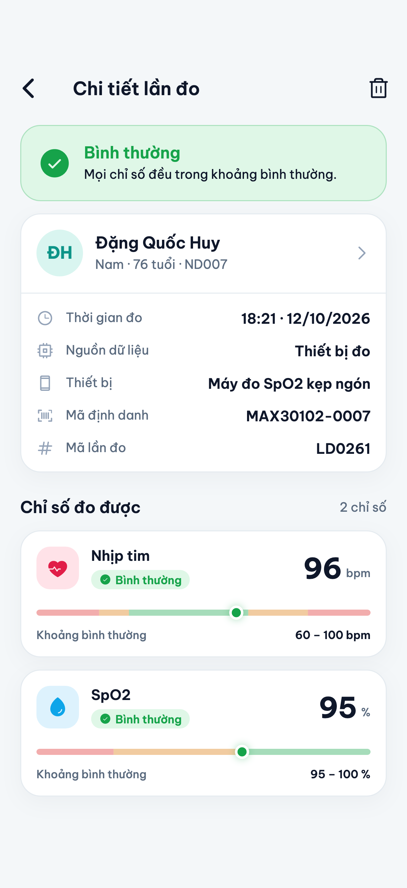
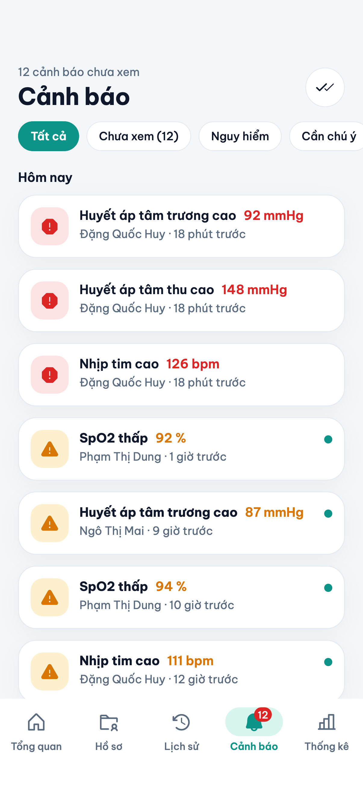
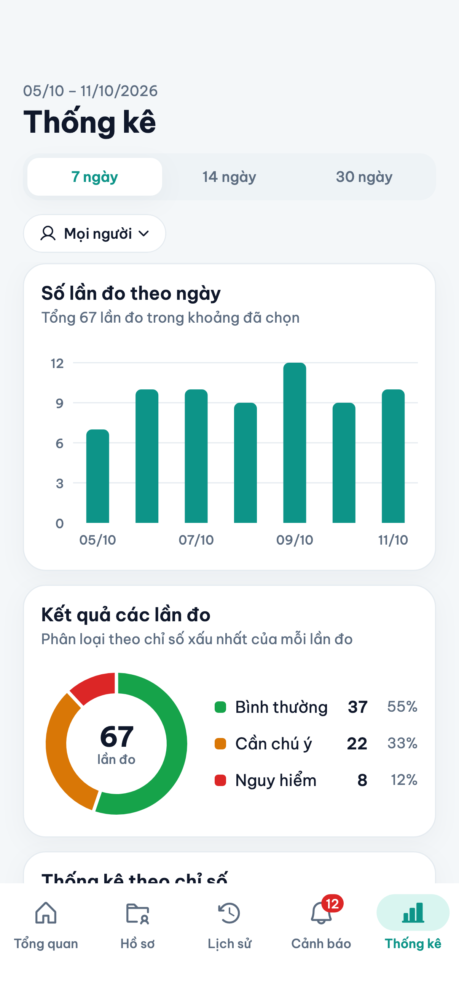

# Phần 12 — Giao diện và kiểm thử

**Người phụ trách:** Người 12 · **Script:** [`sql/sqlserver/11_kiem_thu.sql`](../sql/sqlserver/11_kiem_thu.sql) · **Test tự động:** [`test/`](../test)

## 1. Phạm vi kiểm thử

| Đối tượng | Cách kiểm thử | Số ca |
|---|---|---|
| Cơ sở dữ liệu SQL Server (sản phẩm nộp) | Script `11_kiem_thu.sql` chạy trên SQL Server 2022 | 85 |
| Tầng dữ liệu của ứng dụng: ràng buộc, trigger, view | `test/co_so_du_lieu_test.dart` | 37 |
| Ứng dụng, từ giao diện tới cơ sở dữ liệu | `test/app_smoke_test.dart` | 7 |

Nội dung kiểm thử theo yêu cầu của đề tài: thêm / sửa / xóa, khóa chính, khóa ngoại, dữ liệu không hợp lệ, tìm kiếm, lọc và thống kê; bổ sung thêm ràng buộc duy nhất, xóa dây chuyền và trigger.

## 2. Môi trường

| Thành phần | Phiên bản |
|---|---|
| SQL Server | 2022 Developer, chạy trong Docker (`tool/sqlserver.sh`) |
| Flutter / Dart | 3.47 / 3.13 |
| Dữ liệu | Dữ liệu mẫu: 12 người dùng, 6 thiết bị, 265 lần đo, 1110 giá trị đo, 108 cảnh báo |

## 3. Phương pháp

Mỗi ca kiểm thử trên SQL Server chạy trong một giao dịch rồi `ROLLBACK`, nên các ca độc lập với nhau và dữ liệu mẫu còn nguyên sau khi kiểm thử. Có hai kiểu ca:

- **Ca phải bị từ chối** — chạy một lệnh vi phạm ràng buộc và đối chiếu **mã lỗi** cùng **tên ràng buộc** trong thông báo lỗi. Ca chỉ đạt khi lệnh bị chặn bởi đúng ràng buộc mong đợi, không phải bởi một lỗi tình cờ nào khác.
- **Ca phải cho đúng giá trị** — chạy một đoạn lệnh rồi so một con số với giá trị mong đợi.

Mã lỗi thường gặp của SQL Server:

| Mã | Ý nghĩa |
|---|---|
| 2627 | Trùng khóa chính hoặc ràng buộc `UNIQUE` |
| 2601 | Trùng chỉ mục duy nhất |
| 547 | Vi phạm khóa ngoại hoặc `CHECK` |
| 515 | Gán `NULL` cho cột `NOT NULL` |
| 50001 – 50004 | Lỗi do trigger và thủ tục của hệ thống tự báo |

## 4. Kết quả kiểm thử trên SQL Server

Bảng dưới đây là đầu ra của `11_kiem_thu.sql`.

### Khóa chính

| Mã | Mục tiêu kiểm thử | Kết quả mong đợi | Kết quả thực tế | Kết luận |
|---|---|---|---|:---:|
| PK-01 | Thêm người dùng trùng MaNguoiDung = 1 | Bị từ chối, lỗi 2627 (PK_NGUOI_DUNG) | Lỗi 2627: Violation of PRIMARY KEY constraint 'PK_NGUOI_DUNG'. Cannot insert duplicate key in object 'dbo.N… | **ĐẠT** |
| PK-02 | Thêm lại chỉ số đã có trong lần đo (trùng khóa chính kép) | Bị từ chối, lỗi 2627 (PK_CHI_TIET_LAN_DO) | Lỗi 2627: Violation of PRIMARY KEY constraint 'PK_CHI_TIET_LAN_DO'. Cannot insert duplicate key in object '… | **ĐẠT** |
| PK-03 | Thêm thiết bị trùng MaThietBi = 1 | Bị từ chối, lỗi 2627 (PK_THIET_BI) | Lỗi 2627: Violation of PRIMARY KEY constraint 'PK_THIET_BI'. Cannot insert duplicate key in object 'dbo.THI… | **ĐẠT** |

### Ràng buộc duy nhất

| Mã | Mục tiêu kiểm thử | Kết quả mong đợi | Kết quả thực tế | Kết luận |
|---|---|---|---|:---:|
| UQ-01 | Lập hồ sơ thứ hai cho cùng một người (vi phạm quan hệ 1–1) | Bị từ chối, lỗi 2627 (UQ_HO_SO_SUC_KHOE_MaNguoiDung) | Lỗi 2627: Violation of UNIQUE KEY constraint 'UQ_HO_SO_SUC_KHOE_MaNguoiDung'. Cannot insert duplicate key i… | **ĐẠT** |
| UQ-02 | Thêm thiết bị trùng mã định danh | Bị từ chối, lỗi 2627 (UQ_THIET_BI_MaDinhDanh) | Lỗi 2627: Violation of UNIQUE KEY constraint 'UQ_THIET_BI_MaDinhDanh'. Cannot insert duplicate key in objec… | **ĐẠT** |
| UQ-03 | Thêm người dùng trùng email | Bị từ chối, lỗi 2601 (UQ_NGUOI_DUNG_Email) | Lỗi 2601: Cannot insert duplicate key row in object 'dbo.NGUOI_DUNG' with unique index 'UQ_NGUOI_DUNG_Email… | **ĐẠT** |
| UQ-04 | Hai người dùng cùng không có email vẫn thêm được | 3 | 3 | **ĐẠT** |
| UQ-05 | Thêm loại chỉ số trùng ký hiệu | Bị từ chối, lỗi 2627 (UQ_LOAI_CHI_SO_KyHieu) | Lỗi 2627: Violation of UNIQUE KEY constraint 'UQ_LOAI_CHI_SO_KyHieu'. Cannot insert duplicate key in object… | **ĐẠT** |

### Khóa ngoại

| Mã | Mục tiêu kiểm thử | Kết quả mong đợi | Kết quả thực tế | Kết luận |
|---|---|---|---|:---:|
| FK-01 | Lập hồ sơ cho người dùng không tồn tại | Bị từ chối, lỗi 547 (FK_HO_SO_SUC_KHOE_NGUOI_DUNG) | Lỗi 547: The INSERT statement conflicted with the FOREIGN KEY constraint "FK_HO_SO_SUC_KHOE_NGUOI_DUNG". Th… | **ĐẠT** |
| FK-02 | Thêm lần đo cho người dùng không tồn tại | Bị từ chối, lỗi 547 (FK_LAN_DO_NGUOI_DUNG) | Lỗi 547: The INSERT statement conflicted with the FOREIGN KEY constraint "FK_LAN_DO_NGUOI_DUNG". The confli… | **ĐẠT** |
| FK-03 | Thêm lần đo bằng thiết bị không tồn tại | Bị từ chối, lỗi 547 (FK_LAN_DO_THIET_BI) | Lỗi 547: The INSERT statement conflicted with the FOREIGN KEY constraint "FK_LAN_DO_THIET_BI". The conflict… | **ĐẠT** |
| FK-04 | Thêm giá trị đo cho loại chỉ số không tồn tại | Bị từ chối, lỗi 547 (FK_CHI_TIET_LAN_DO_LOAI_CHI_SO) | Lỗi 547: The INSERT statement conflicted with the FOREIGN KEY constraint "FK_CHI_TIET_LAN_DO_LOAI_CHI_SO".… | **ĐẠT** |
| FK-05 | Thêm giá trị đo cho lần đo không tồn tại | Bị từ chối, lỗi 547 (FK_CHI_TIET_LAN_DO_LAN_DO) | Lỗi 547: The INSERT statement conflicted with the FOREIGN KEY constraint "FK_CHI_TIET_LAN_DO_LAN_DO". The c… | **ĐẠT** |
| FK-06 | Xóa thiết bị đã có lần đo | Bị từ chối, lỗi 547 (FK_LAN_DO_THIET_BI) | Lỗi 547: The DELETE statement conflicted with the REFERENCE constraint "FK_LAN_DO_THIET_BI". The conflict o… | **ĐẠT** |
| FK-07 | Xóa loại chỉ số đã có giá trị đo | Bị từ chối, lỗi 547 (FK_CHI_TIET_LAN_DO_LOAI_CHI_SO) | Lỗi 547: The DELETE statement conflicted with the REFERENCE constraint "FK_CHI_TIET_LAN_DO_LOAI_CHI_SO". Th… | **ĐẠT** |
| FK-08 | Thêm cảnh báo cho giá trị đo không tồn tại | Bị từ chối, lỗi 547 (FK_CANH_BAO_CHI_TIET_LAN_DO) | Lỗi 547: The INSERT statement conflicted with the FOREIGN KEY constraint "FK_CANH_BAO_CHI_TIET_LAN_DO". The… | **ĐẠT** |

### Xóa dây chuyền

| Mã | Mục tiêu kiểm thử | Kết quả mong đợi | Kết quả thực tế | Kết luận |
|---|---|---|---|:---:|
| CS-01 | Xóa người dùng 12: hồ sơ, lần đo, giá trị đo của họ mất theo | 0 | 0 | **ĐẠT** |
| CS-02 | Xóa người dùng 12: tổng số lần đo giảm đúng 15 | 250 | 250 | **ĐẠT** |
| CS-03 | Xóa lần đo 260: 5 giá trị đo và 3 cảnh báo của nó mất theo | 0 | 0 | **ĐẠT** |
| CS-04 | Xóa một giá trị đo: cảnh báo của nó mất theo, cảnh báo khác còn | 2 | 2 | **ĐẠT** |
| CS-05 | Xóa hồ sơ không làm mất người dùng | 1 | 1 | **ĐẠT** |

### Dữ liệu không hợp lệ (CHECK, NOT NULL)

| Mã | Mục tiêu kiểm thử | Kết quả mong đợi | Kết quả thực tế | Kết luận |
|---|---|---|---|:---:|
| CK-01 | Giới tính ngoài danh sách cho phép | Bị từ chối, lỗi 547 (CK_NGUOI_DUNG_GioiTinh) | Lỗi 547: The INSERT statement conflicted with the CHECK constraint "CK_NGUOI_DUNG_GioiTinh". The conflict o… | **ĐẠT** |
| CK-02 | Ngày sinh ở tương lai | Bị từ chối, lỗi 547 (CK_NGUOI_DUNG_NgaySinh) | Lỗi 547: The INSERT statement conflicted with the CHECK constraint "CK_NGUOI_DUNG_NgaySinh". The conflict o… | **ĐẠT** |
| CK-03 | Họ tên chỉ có một ký tự | Bị từ chối, lỗi 547 (CK_NGUOI_DUNG_HoTen) | Lỗi 547: The INSERT statement conflicted with the CHECK constraint "CK_NGUOI_DUNG_HoTen". The conflict occu… | **ĐẠT** |
| CK-04 | Số điện thoại có chữ cái | Bị từ chối, lỗi 547 (CK_NGUOI_DUNG_SoDienThoai) | Lỗi 547: The INSERT statement conflicted with the CHECK constraint "CK_NGUOI_DUNG_SoDienThoai". The conflic… | **ĐẠT** |
| CK-05 | Email sai định dạng | Bị từ chối, lỗi 547 (CK_NGUOI_DUNG_Email) | Lỗi 547: The INSERT statement conflicted with the CHECK constraint "CK_NGUOI_DUNG_Email". The conflict occu… | **ĐẠT** |
| CK-06 | Họ tên để trống (NULL) | Bị từ chối, lỗi 515 | Lỗi 515: Cannot insert the value NULL into column 'HoTen', table 'QuanLyHoSoSucKhoe.dbo.NGUOI_DUNG'; column… | **ĐẠT** |
| CK-07 | Chiều cao bằng 0 | Bị từ chối, lỗi 547 (CK_HO_SO_SUC_KHOE_ChieuCao) | Lỗi 547: The UPDATE statement conflicted with the CHECK constraint "CK_HO_SO_SUC_KHOE_ChieuCao". The confli… | **ĐẠT** |
| CK-08 | Cân nặng âm | Bị từ chối, lỗi 547 (CK_HO_SO_SUC_KHOE_CanNang) | Lỗi 547: The UPDATE statement conflicted with the CHECK constraint "CK_HO_SO_SUC_KHOE_CanNang". The conflic… | **ĐẠT** |
| CK-09 | Nhóm máu không tồn tại | Bị từ chối, lỗi 547 (CK_HO_SO_SUC_KHOE_NhomMau) | Lỗi 547: The UPDATE statement conflicted with the CHECK constraint "CK_HO_SO_SUC_KHOE_NhomMau". The conflic… | **ĐẠT** |
| CK-10 | Trạng thái thiết bị ngoài danh sách | Bị từ chối, lỗi 547 (CK_THIET_BI_TrangThai) | Lỗi 547: The UPDATE statement conflicted with the CHECK constraint "CK_THIET_BI_TrangThai". The conflict oc… | **ĐẠT** |
| CK-11 | Nguồn "Thiết bị" nhưng không có mã thiết bị | Bị từ chối, lỗi 547 (CK_LAN_DO_NguonKhopThietBi) | Lỗi 547: The INSERT statement conflicted with the CHECK constraint "CK_LAN_DO_NguonKhopThietBi". The confli… | **ĐẠT** |
| CK-12 | Nguồn "Thủ công" nhưng lại có mã thiết bị | Bị từ chối, lỗi 547 (CK_LAN_DO_NguonKhopThietBi) | Lỗi 547: The INSERT statement conflicted with the CHECK constraint "CK_LAN_DO_NguonKhopThietBi". The confli… | **ĐẠT** |
| CK-13 | Thời gian đo ở tương lai | Bị từ chối, lỗi 547 (CK_LAN_DO_ThoiGianDo) | Lỗi 547: The INSERT statement conflicted with the CHECK constraint "CK_LAN_DO_ThoiGianDo". The conflict occ… | **ĐẠT** |
| CK-14 | Mức độ cảnh báo ngoài danh sách | Bị từ chối, lỗi 547 (CK_CANH_BAO_MucDo) | Lỗi 547: The UPDATE statement conflicted with the CHECK constraint "CK_CANH_BAO_MucDo". The conflict occurr… | **ĐẠT** |
| CK-15 | Ngưỡng của chỉ số sai thứ tự (bình thường rộng hơn cảnh báo) | Bị từ chối, lỗi 547 (CK_LOAI_CHI_SO_ThuTuNguong) | Lỗi 547: The UPDATE statement conflicted with the CHECK constraint "CK_LOAI_CHI_SO_ThuTuNguong". The confli… | **ĐẠT** |

### Trigger

| Mã | Mục tiêu kiểm thử | Kết quả mong đợi | Kết quả thực tế | Kết luận |
|---|---|---|---|:---:|
| TG-01 | Giá trị đo ngoài khoảng hợp lệ (nhịp tim 400) bị trigger từ chối | Bị từ chối, lỗi 50001 | Lỗi 50001: Giá trị đo nằm ngoài khoảng hợp lệ của chỉ số. | **ĐẠT** |
| TG-02 | Thêm lần đo có 2 chỉ số bất thường: trigger tạo đúng 2 cảnh báo | 2 | 2 | **ĐẠT** |
| TG-03 | Nhịp tim 135 (ngoài khoảng 50–120) được xếp mức "Nguy hiểm" | 1 | 1 | **ĐẠT** |
| TG-04 | SpO2 93 (trong khoảng 90–95) được xếp mức "Cần chú ý" | 1 | 1 | **ĐẠT** |
| TG-05 | Lần đo toàn giá trị bình thường: không sinh cảnh báo | 0 | 0 | **ĐẠT** |
| TG-06 | Giá trị ở đúng biên khoảng bình thường (nhịp tim 100): không cảnh báo | 0 | 0 | **ĐẠT** |
| TG-07 | Sửa giá trị về bình thường: cảnh báo của nó tự biến mất | 0 | 0 | **ĐẠT** |
| TG-08 | Sửa giá trị từ bình thường sang bất thường: cảnh báo được tạo | 1 | 1 | **ĐẠT** |
| TG-09 | Thời điểm của cảnh báo trùng với thời gian đo | 0 | 0 | **ĐẠT** |
| TG-10 | Sửa hồ sơ: trigger tự cập nhật NgayCapNhat về hôm nay | 0 | 0 | **ĐẠT** |

### Thêm, sửa, xóa

| Mã | Mục tiêu kiểm thử | Kết quả mong đợi | Kết quả thực tế | Kết luận |
|---|---|---|---|:---:|
| CR-01 | Thêm một người dùng: tổng số tăng từ 12 lên 13 | 13 | 13 | **ĐẠT** |
| CR-02 | Sửa số điện thoại của một người dùng | 1 | 1 | **ĐẠT** |
| CR-03 | Xóa một người dùng: tổng số giảm từ 12 xuống 11 | 11 | 11 | **ĐẠT** |
| CR-04 | SP_ThemLanDo với 5 chỉ số: lưu đủ 5 giá trị đo | 5 | 5 | **ĐẠT** |
| CR-05 | SP_ThemLanDo không có mã thiết bị: nguồn là "Thủ công" | 1 | 1 | **ĐẠT** |
| CR-06 | SP_ThemLanDo không có chỉ số nào | Bị từ chối, lỗi 50002 | Lỗi 50002: Một lần đo phải có ít nhất một chỉ số. | **ĐẠT** |
| CR-07 | SP_ThemLanDo chỉ có huyết áp tâm thu, thiếu tâm trương | Bị từ chối, lỗi 50003 | Lỗi 50003: Huyết áp phải nhập đủ cả tâm thu và tâm trương. | **ĐẠT** |
| CR-08 | SP_ThemLanDo có tâm thu nhỏ hơn tâm trương | Bị từ chối, lỗi 50004 | Lỗi 50004: Huyết áp tâm thu phải lớn hơn huyết áp tâm trương. | **ĐẠT** |
| CR-09 | SP_ThemLanDo gặp giá trị không hợp lệ: không để lại lần đo dở dang | 265 | 265 | **ĐẠT** |
| CR-10 | Đánh dấu đã xem toàn bộ cảnh báo của người dùng 7 | 0 | 0 | **ĐẠT** |

### Tìm kiếm và lọc

| Mã | Mục tiêu kiểm thử | Kết quả mong đợi | Kết quả thực tế | Kết luận |
|---|---|---|---|:---:|
| TK-01 | Tìm tên không dấu "bich" ra 1 người (Trần Thị Bích) | 1 | 1 | **ĐẠT** |
| TK-02 | Tìm "duc" khớp cả chữ Đ (Hoàng Minh Đức) | 1 | 1 | **ĐẠT** |
| TK-03 | Tìm "thi" ra 6 người có tên đệm Thị | 6 | 6 | **ĐẠT** |
| TK-04 | Tìm từ khóa không có trong dữ liệu trả về 0 dòng | 0 | 0 | **ĐẠT** |
| TK-05 | Lọc giới tính Nữ: 6 người | 6 | 6 | **ĐẠT** |
| TK-06 | Lọc từ 60 tuổi (tính đến 10/10/2026): 3 người | 3 | 3 | **ĐẠT** |
| TK-07 | Lọc 18–39 tuổi (tính đến 10/10/2026): 4 người | 4 | 4 | **ĐẠT** |
| TK-08 | Tuổi tính đúng vào ngày sinh nhật (Lý Thị Oanh, sinh 10/10/2005) | 2120 | 2120 | **ĐẠT** |
| TK-09 | Lọc nhóm máu O (O+ và O-): 4 người | 4 | 4 | **ĐẠT** |
| TK-10 | Lọc thiết bị đang hoạt động: 4 thiết bị | 4 | 4 | **ĐẠT** |
| TK-11 | Lịch sử đo trong ngày 10/10/2026: 15 lần đo | 15 | 15 | **ĐẠT** |
| TK-12 | Lịch sử đo từ 04/10 đến 10/10/2026: 62 lần đo | 62 | 62 | **ĐẠT** |
| TK-13 | Lịch sử đo của người dùng 7: 35 lần đo | 35 | 35 | **ĐẠT** |
| TK-14 | Lọc lần đo nhập thủ công: 55 lần đo | 55 | 55 | **ĐẠT** |
| TK-15 | Lọc cảnh báo mức nguy hiểm: 16 cảnh báo | 16 | 16 | **ĐẠT** |
| TK-16 | Lọc cảnh báo chưa xem: 17 cảnh báo | 17 | 17 | **ĐẠT** |
| TK-17 | Cảnh báo của người dùng 7: 38 cảnh báo | 38 | 38 | **ĐẠT** |

### Thống kê

| Mã | Mục tiêu kiểm thử | Kết quả mong đợi | Kết quả thực tế | Kết luận |
|---|---|---|---|:---:|
| ST-01 | Tổng số lần đo của dữ liệu mẫu | 265 | 265 | **ĐẠT** |
| ST-02 | Tổng số giá trị đo của dữ liệu mẫu | 1110 | 1110 | **ĐẠT** |
| ST-03 | Số cảnh báo bằng đúng số giá trị ngoài khoảng bình thường | 0 | 0 | **ĐẠT** |
| ST-04 | View V_LAN_DO_TONG_HOP có đúng một dòng cho mỗi lần đo | 265 | 265 | **ĐẠT** |
| ST-05 | Cộng số lần đo theo từng người (GROUP BY) ra đúng tổng | 265 | 265 | **ĐẠT** |
| ST-06 | Số lần đo có kết quả "Bình thường": 179 | 179 | 179 | **ĐẠT** |
| ST-07 | Ba mức độ của lần đo cộng lại bằng tổng số lần đo | 265 | 265 | **ĐẠT** |
| ST-08 | HAVING: 5 người có từ 25 lần đo trở lên | 5 | 5 | **ĐẠT** |
| ST-09 | Nhịp tim trung bình toàn bộ dữ liệu: 80,5 bpm (so sánh × 10) | 805 | 805 | **ĐẠT** |
| ST-10 | Huyết áp tâm thu cao nhất: 148 mmHg | 148 | 148 | **ĐẠT** |
| ST-11 | SpO2 thấp nhất: 92 % | 92 | 92 | **ĐẠT** |
| ST-12 | View V_HO_SO_TONG_HOP: tổng cột SoLanDo bằng tổng số lần đo | 265 | 265 | **ĐẠT** |

**Tổng kết: 85/85 ca đạt, 0 ca không đạt.**

Sau khi chạy xong, số dòng của các bảng vẫn như ban đầu:

| NguoiDung | HoSo | ThietBi | LanDo | ChiTiet | CanhBao |
|---|---|---|---|---|---|
| 12 | 12 | 6 | 265 | 1110 | 108 |

## 5. Kiểm thử trên ứng dụng

### 5.1 Tầng dữ liệu của ứng dụng

`test/co_so_du_lieu_test.dart` tạo cho mỗi ca một cơ sở dữ liệu mới, đủ bảng, trigger, view và dữ liệu mẫu. 37 ca thuộc các nhóm:

| Nhóm | Số ca | Nội dung |
|---|:---:|---|
| Tìm kiếm không dấu | 2 | Bỏ dấu tiếng Việt; tìm tên không phân biệt dấu trong truy vấn |
| Dữ liệu mẫu | 4 | Đủ số dòng; mốc thời gian được dịch về hiện tại; đặt lại dữ liệu mẫu |
| Khóa chính và duy nhất | 4 | Khóa chính kép, hồ sơ 1–1, email, mã định danh thiết bị |
| Khóa ngoại | 4 | Tham chiếu không tồn tại; không xóa được thiết bị đang dùng |
| Xóa dây chuyền | 2 | Xóa người dùng, xóa lần đo |
| Dữ liệu không hợp lệ | 6 | Giới tính, ngày sinh, số điện thoại, chiều cao, cân nặng, nhóm máu, nguồn dữ liệu, thời gian đo |
| Trigger cảnh báo | 7 | Từ chối giá trị sai; đúng mức độ; đúng câu mô tả; sửa giá trị |
| Trigger ngày cập nhật | 1 | `NgayCapNhat` được ghi lại khi sửa hồ sơ |
| View và thống kê | 5 | Số dòng của view, phân bố mức độ, `HAVING`, trung bình / lớn nhất / nhỏ nhất |
| Xử lý lỗi và giao dịch | 2 | Lỗi ràng buộc đổi thành thông báo tiếng Việt; giao dịch bị hủy trọn vẹn |

### 5.2 Từ giao diện tới cơ sở dữ liệu

`test/app_smoke_test.dart` dựng toàn bộ ứng dụng trên một cơ sở dữ liệu mới nạp dữ liệu mẫu rồi thao tác như người dùng:

| Ca | Thao tác | Kết quả kiểm tra |
|---|---|---|
| 1 | Mở ứng dụng | Tổng quan hiển thị số liệu từ cơ sở dữ liệu |
| 2 | Tab Hồ sơ, gõ "bich" | Liệt kê 12 hồ sơ; tìm không dấu ra đúng "Trần Thị Bích" |
| 3 | Mở lần lượt Lịch sử, Cảnh báo, Thống kê | Mỗi tab hiển thị nội dung của nó |
| 4 | Chạm vào một hồ sơ | Mở chi tiết hồ sơ |
| 5 | Thêm lần đo có nhịp tim 135 bpm | `LAN_DO` tăng 1, `CANH_BAO` tăng 1 (do trigger); màn hình chi tiết hiện "Nguy hiểm" và "Nhịp tim cao" |
| 6 | Thêm lần đo có nhịp tim 400 bpm | Form báo "Phải trong khoảng 20 – 250 bpm"; không ghi gì vào cơ sở dữ liệu |
| 7 | Xóa hồ sơ của Lý Thị Oanh | Người dùng còn 11, hồ sơ còn 11, lần đo giảm 15 (xóa dây chuyền) |

Chạy toàn bộ:

```bash
flutter test
```

Kết quả hiện tại: 44/44 ca đạt.

### 5.3 Giao diện

Các màn hình theo yêu cầu của đề tài — danh sách hồ sơ, chi tiết hồ sơ, lịch sử đo, chi tiết lần đo, cảnh báo và thống kê — được chụp lại tự động bằng `tool/chup_man_hinh_test.dart`:

| Danh sách hồ sơ | Chi tiết hồ sơ | Lịch sử đo |
|---|---|---|
|  |  |  |

| Chi tiết lần đo | Cảnh báo | Thống kê |
|---|---|---|
|  |  |  |

Toàn bộ ảnh (gồm cả giao diện tối và các form nhập) nằm trong thư mục [`screenshots`](screenshots).

## 6. Lỗi phát hiện trong quá trình kiểm thử

| # | Hiện tượng | Nguyên nhân | Cách khắc phục |
|---|---|---|---|
| 1 | Tìm "duc" không ra "Hoàng Minh Đức", tìm "duong" không ra "Dương Văn Nam" | Collation `Vietnamese_CI_AI` coi đ, ư, ơ là chữ cái riêng chứ không phải chữ có dấu | Dùng `COLLATE Latin1_General_CI_AI` cho phép tìm kiếm (ca TK-02) |
| 2 | Mã cảnh báo của dữ liệu mẫu không theo thứ tự lần đo và không bảo đảm giống nhau giữa các lần nạp | Lệnh `INSERT … SELECT` trong trigger không có `ORDER BY`, nên thứ tự cấp `IDENTITY` không xác định | Thêm `ORDER BY MaLanDo, MaLoaiChiSo` vào trigger |
| 3 | Gọi `SP_ThemLanDo` với giá trị sai bên trong một giao dịch khác thì nhận lỗi 266 thay vì lỗi 50001 | `ROLLBACK` trong trigger hủy luôn giao dịch của nơi gọi | Thủ tục kiểm tra khoảng hợp lệ trước khi mở giao dịch (ca CR-09) |
| 4 | Thủ tục kiểm thử báo "Cannot resolve collation conflict" | Thủ tục tạm nằm trong `tempdb`, có collation khác với cơ sở dữ liệu | Thêm `COLLATE DATABASE_DEFAULT` khi so sánh chuỗi |
| 5 | Màn hình chi tiết lần đo bị tràn chữ ở dòng "Khoảng bình thường" | Hai đoạn chữ đặt cạnh nhau không co giãn | Cho đoạn chữ bên trái co lại khi thiếu chỗ (phát hiện bởi ca 5 ở mục 5.2) |

## 7. Giới hạn

- Bản IPA và APK của ứng dụng được build thành công nhưng **chưa được chạy trên thiết bị thật** trong quá trình kiểm thử này; ứng dụng mới được chạy ở chế độ debug trên iOS Simulator.
- Chưa có kiểm thử hiệu năng: dữ liệu mẫu chỉ có vài trăm lần đo.
- Ngưỡng cảnh báo là giá trị tham khảo phục vụ đồ án, chưa được chuyên gia y tế thẩm định.
